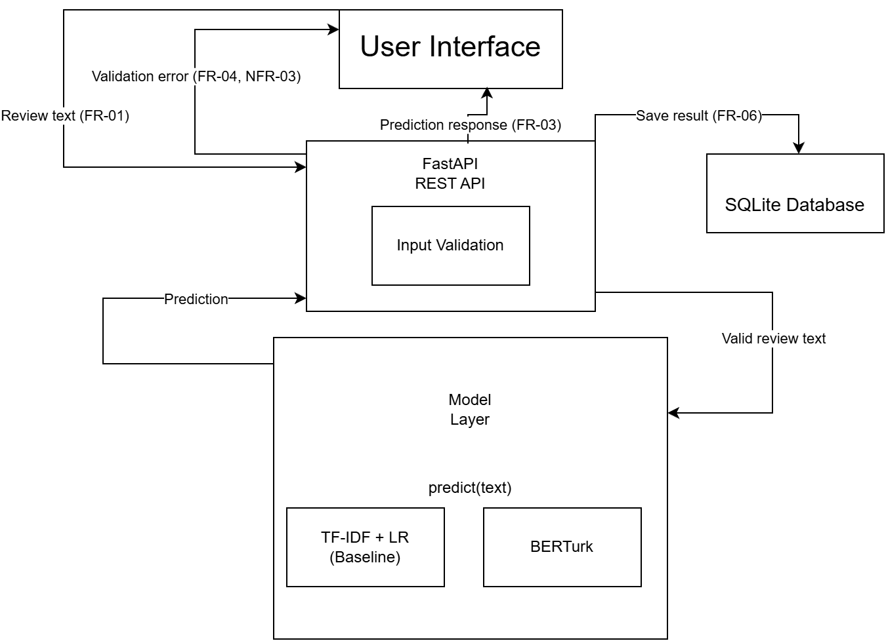
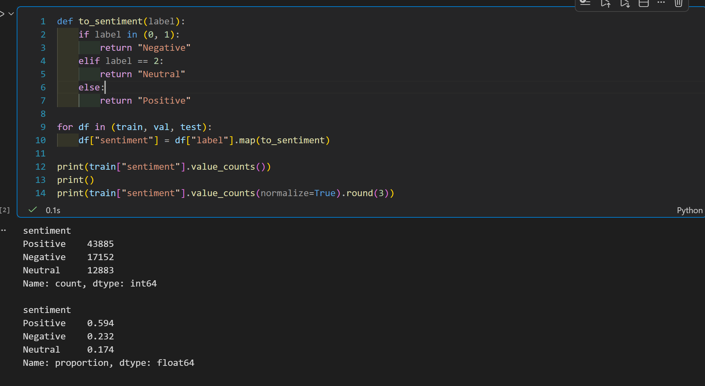
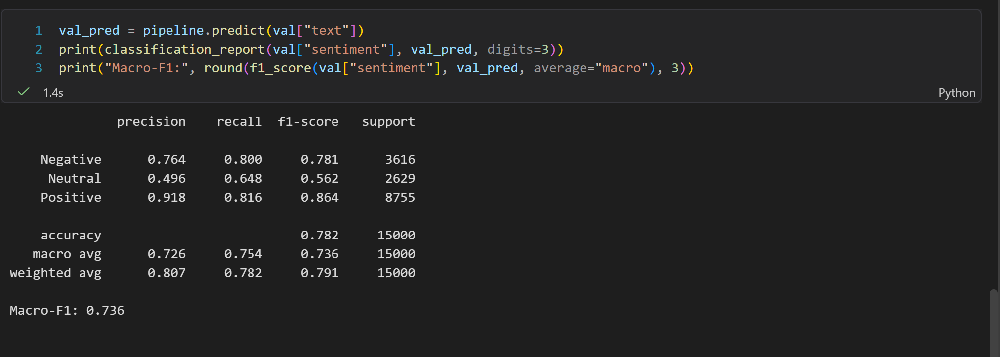
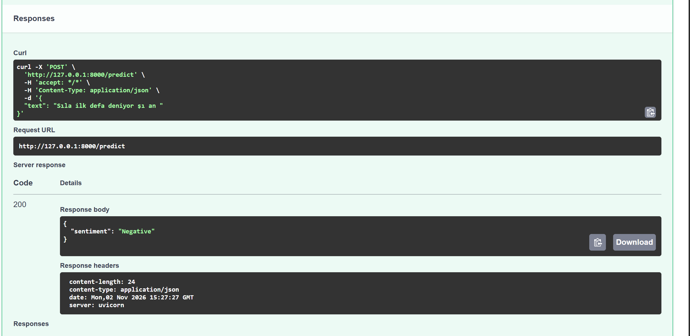
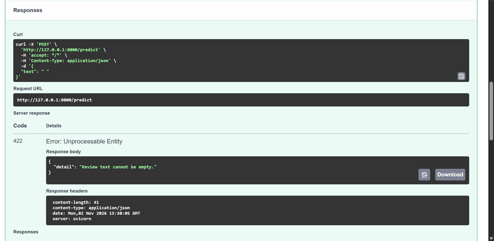

# Graduation Project Report

**ALTINBAŞ UNIVERSITY**
Faculty of Engineering and Architecture
Software Engineering Department

## Turkish Customer Review Classification Service

**Student:** Sıla Yılan
**Student Number:** 220513357
**Instructor:** Dr. Öğr. Üye. Fatma Kuzey Edeş Huyal
**Academic Year:** 2026–2027

**GitHub Repository:** https://github.com/silasea/turkish-review-classifier

---

## 1. Introduction

E-commerce platforms generate substantial amounts of textual customer feedback through product reviews. Analyzing this information can help businesses understand customer satisfaction, evaluate product quality, and identify recurring issues. Natural Language Processing (NLP) provides techniques for automatically processing and classifying such text. This project focuses on developing a Turkish customer review classification service that combines machine learning, an API, automated testing, and containerization.

## 2. Problem Statement

Manually analyzing large volumes of customer reviews requires considerable time and effort. Manual classification can also be inconsistent, making it difficult to identify patterns across thousands of reviews. Consequently, businesses may overlook important complaints or fail to recognize changes in customer sentiment. An automated system is needed to classify Turkish customer reviews consistently and efficiently.

## 3. Motivation

Customer feedback is an important source of information for improving products and services. Efficient review analysis can help businesses recognize customer concerns and make more informed decisions. From a software engineering perspective, this project also provides an opportunity to develop an end-to-end NLP application that combines model training, API development, testing, and reproducible deployment.

## 4. Project Objective

The primary objective is to develop a working NLP service that classifies Turkish e-commerce reviews by sentiment. The project will establish a TF-IDF and Logistic Regression baseline and compare it with a fine-tuned Turkish language encoder. The models will be evaluated using appropriate classification metrics. The selected model will then be integrated into a FastAPI service with a simple user interface, automated tests, and Docker-based packaging.

## 5. Preliminary Scope

The project will include data preprocessing, baseline model development using TF-IDF and Logistic Regression, fine-tuning a Turkish language encoder, model evaluation, REST API development with FastAPI, a simple user interface, automated testing with pytest, and Docker-based containerization. SQLite will be used for storing sentiment analysis results.

The initial version will focus exclusively on Turkish customer reviews and sentiment classification. User authentication, account management, multilingual support, and cloud deployment are outside the initial scope and may be considered in future work.

## 6. Dataset

The project will use the MüşteriYorumları dataset, which contains approximately 103,000 Turkish e-commerce reviews from Hepsiburada and Trendyol with ratings from one to five stars. The dataset will be examined to assess its structure, label distribution, and data quality. Star ratings will be mapped to three sentiment classes: ratings of 1-2 as Negative, 3 as Neutral, and 4-5 as Positive. This mapping will be verified during dataset inspection by examining representative reviews from each rating level.

## 7. Requirements Analysis

The primary user of this project is a customer experience team member working for an e-commerce business. This user needs to analyze customer reviews to understand customer sentiment and identify negative feedback. Manually reading and classifying large numbers of reviews can be time-consuming and make it difficult to identify negative comments efficiently.

The proposed system will provide a Turkish customer review sentiment classification service. Its main objective is to predict the sentiment class of a Turkish review and return the result to the user. The first prototype will focus on three essential capabilities: accepting review text, classifying the text using a machine learning model, and displaying the predicted sentiment. A simple and functional interface may be included to demonstrate this workflow. More advanced interface design, bulk review uploads, and analysis history will be postponed until the core classification process works reliably. The dataset will be finalized after its suitability and data quality have been evaluated.

## 8. Project Scope

### In Scope

- Accepting Turkish customer reviews as text input.
- Classifying reviews into Positive, Neutral, or Negative sentiment classes.
- Displaying predictions through a FastAPI-based REST API and a simple user interface.
- Comparing a TF-IDF and Logistic Regression baseline with a fine-tuned Turkish language model.
- Evaluating model performance using classification metrics, including macro-F1.
- Storing analysis results in an SQLite database.
- Testing and packaging the application using pytest and Docker.

### Out of Scope

- User authentication and account management.
- Multilingual sentiment classification.
- Bulk review uploads and advanced review analytics.
- Cloud deployment in the initial version.

## 9. Functional Requirements

| ID    | Requirement statement                                                                                           | Priority |
| ----- | --------------------------------------------------------------------------------------------------------------- | -------- |
| FR-01 | The system shall accept a Turkish customer review as text input.                                                | Must     |
| FR-02 | The system shall classify an input review into one of three sentiment classes: Positive, Neutral, or Negative.  | Must     |
| FR-03 | The system shall display the predicted sentiment class to the user.                                             | Must     |
| FR-04 | The system shall reject empty or whitespace-only review input and display a clear validation message.           | Must     |
| FR-05 | The system shall expose the sentiment classification functionality through a REST API implemented with FastAPI. | Must     |
| FR-06 | The system shall store each analysis result in an SQLite database for later retrieval.                          | Should   |

## 10. Non-Functional Requirements

| ID     | Quality                | Requirement                                                                                                                                                                        | How to verify                                                                                                             |
| ------ | ---------------------- | ---------------------------------------------------------------------------------------------------------------------------------------------------------------------------------- | ------------------------------------------------------------------------------------------------------------------------- |
| NFR-01 | Performance            | The system shall return a sentiment prediction within 2 seconds for a single review of up to 500 characters, excluding initial model loading, on the specified development laptop. | Measure response time across 30 individual requests and check whether each prediction meets the target.                   |
| NFR-02 | Classification quality | The selected model shall achieve a macro-F1 score of at least 0.75 on a held-out test set containing all three sentiment classes.                                                  | Evaluate the trained model on a test set that was not used for training or model selection, and calculate macro-F1.       |
| NFR-03 | Input validation       | The system shall return an appropriate validation error for empty or whitespace-only input without attempting sentiment classification.                                            | Submit empty and whitespace-only inputs through the API and verify the error response and that no prediction is produced. |

## 11. Constraints and Assumptions

### Constraints

**CON-01 — Development Time:** The project must be developed within the nine-week graduation project schedule. Therefore, development will prioritize a working prototype and essential functionality over advanced features.

**CON-02 — Computational Resources:** Model training and fine-tuning will be limited by the available hardware and computational resources. Free cloud GPU services may be used when available, but their availability and usage limits cannot be guaranteed.

### Assumptions

**ASM-01 — Dataset Label Quality:** The selected dataset is assumed to contain sufficiently reliable review ratings for deriving Positive, Neutral, and Negative sentiment labels. This assumption will be examined by inspecting the dataset, its rating distribution, and representative reviews before finalizing the label mapping.

## 12. Use Cases

### US-01: Classify a Customer Review

As a customer experience team member, I want to submit a Turkish customer review and see its predicted sentiment class, so that I can identify the general sentiment expressed in the review.

**Related Requirements:** FR-01, FR-02, FR-03

**Acceptance Criteria**

1. Given a valid Turkish customer review, when the user submits the review, then the system shall classify it as Positive, Neutral, or Negative.
2. Given that the classification process has completed, when the system returns the prediction, then the predicted sentiment class shall be displayed to the user.

### US-02: Handle Empty Review Input

As a customer experience team member, I want to receive a clear validation message when I submit an empty review, so that I can correct my input before requesting a sentiment prediction.

**Related Requirements:** FR-04, NFR-03

**Acceptance Criteria**

1. Given an empty or whitespace-only review, when the user submits it, then the system shall reject the input and display a clear validation message.
2. Given an empty or whitespace-only review, when the API receives the request, then it shall return an appropriate validation error without generating a sentiment prediction.

## 13. Development Plan

| Week   | Planned Deliverable                                                                                                                                                                                                                                                        |
| ------ | -------------------------------------------------------------------------------------------------------------------------------------------------------------------------------------------------------------------------------------------------------------------------- |
| Week 3 | Design the system architecture and document two Architecture Decision Records (ADRs): one explaining the choice of SQLite and the other explaining the selection of BERTurk and the use of a common model interface.                                                       |
| Week 4 | Develop an end-to-end baseline using TF-IDF and Logistic Regression. Load and preprocess the dataset, train the baseline model, and create a basic FastAPI service. Integrate the baseline model into the API and demonstrate sentiment prediction through an API request. |
| Week 5 | Fine-tune BERTurk for three-class Turkish sentiment classification. Integrate it into the existing FastAPI service by replacing the baseline model behind the same prediction interface. Verify that the API continues to work with the new model.                         |
| Week 6 | Implement automated tests using pytest and prepare a comparison table for the baseline and BERTurk models using macro-F1, accuracy, precision, and recall. Evaluate both models on the same held-out test set.                                                             |
| Week 7 | Containerize the application using Docker, maintain a requirements.txt file, and verify that the application runs successfully in a clean environment using documented setup instructions.                                                                                 |
| Week 8 | Complete the graduation project report and improve the GitHub README with the project overview, features, scope, technology stack, installation instructions, usage examples, and evaluation results.                                                                      |
| Week 9 | Prepare and deliver the final project demonstration, showing the end-to-end application workflow, sentiment predictions, model evaluation results, and key engineering decisions.                                                                                          |

## 14. Methodology

### Modeling Approach

The project will follow a simple-to-complex modeling approach. First, a TF-IDF and Logistic Regression model will be developed as a baseline, followed by a fine-tuned BERTurk model. Both models will be accessed through a common interface in the Model Layer, allowing the model to be replaced without changing the API. Their performance will be evaluated using the same test set to ensure a fair comparison.

### Justification

This approach is suitable for a one-person project with a nine-week timeline and limited GPU resources. The TF-IDF and Logistic Regression baseline can be implemented quickly and does not require a GPU, making it possible to build a working system early. The more complex BERTurk model can then be developed as the next step. Even if fine-tuning takes longer than expected, the project will still have a functional baseline system.

## 15. System Architecture



**Figure 3.1:** Proposed system architecture showing the main components and the flow of a review from input to prediction.

Figure 3.1 presents the proposed architecture. The User Interface sends the review text to the FastAPI REST API, where input validation checks whether the text is empty or contains only whitespace. Valid text is forwarded to the Model Layer, which produces a sentiment prediction through the common predict(text) interface. The prediction is returned to the API, which stores the result in the SQLite database and returns the predicted class to the User Interface. If validation fails, a validation error is returned to the user and the Model Layer is not called.

### 15.1 Component Responsibilities

| Component        | Responsibility / main input                                                                                                                                                         | Output / connection                                                                                                                                                              |
| ---------------- | ----------------------------------------------------------------------------------------------------------------------------------------------------------------------------------- | -------------------------------------------------------------------------------------------------------------------------------------------------------------------------------- |
| User Interface   | Allows the user to enter a Turkish customer review.                                                                                                                                 | Sends the review text to the FastAPI REST API and displays the predicted sentiment or validation error returned by the API.                                                      |
| FastAPI REST API | Receives review text from the User Interface and manages the classification request. Includes input validation to reject empty or whitespace-only text.                             | Sends valid text to the Model Layer; receives the predicted sentiment; stores the analysis result in SQLite; returns the prediction or a validation error to the User Interface. |
| Model Layer      | Processes valid Turkish review text using the selected sentiment classification model. Provides a common predict(text) interface for both TF-IDF + Logistic Regression and BERTurk. | Produces a predicted sentiment class (Positive, Neutral, or Negative) and sends it back to the FastAPI REST API.                                                                 |
| SQLite Database  | Stores analysis results received from the FastAPI REST API, including the review text, predicted sentiment class, and timestamp.                                                    | Stores the analysis records for later retrieval by the application.                                                                                                              |

### System Boundaries

The entire system will run locally on a single machine during development and demonstration. The User Interface, FastAPI REST API, Model Layer, and SQLite Database will operate within this local environment. The main external dependency is the pre-trained language model downloaded from Hugging Face; its availability and hosting are outside the project's direct control. Once downloaded, the model will run locally during application execution.

### 15.2 End-to-End Execution Scenario

| Step | Component                          | Input, operation, and output                                                                                                                      |
| ---- | ---------------------------------- | ------------------------------------------------------------------------------------------------------------------------------------------------- |
| 1    | User Interface                     | The user enters a Turkish customer review and submits it to the FastAPI REST API.                                                                 |
| 2    | FastAPI REST API                   | Receives the review text through the /predict endpoint and forwards it to input validation.                                                       |
| 3    | Input Validation (within FastAPI)  | Checks whether the review is empty or contains only whitespace. If valid, forwards the text to the Model Layer.                                   |
| 4    | Model Layer                        | Processes the review using the selected classification model through the common predict(text) interface and returns a sentiment class to the API. |
| 5    | FastAPI REST API / SQLite Database | Receives the predicted sentiment and stores the review text, predicted class, and timestamp in SQLite.                                            |
| 6    | FastAPI REST API / User Interface  | Returns the prediction as an API response. The User Interface displays the predicted sentiment to the user.                                       |

### Example API Endpoint

**Endpoint:** `POST /predict`

Request body:

```json
{
  "text": "Ürün çok kaliteli ve hızlı teslim edildi."
}
```

Successful response (HTTP 200 OK):

```json
{
  "sentiment": "Positive"
}
```

The `sentiment` field can contain one of three values: Positive, Neutral, or Negative.

### Error Scenario: Empty Review Input

If the user submits an empty review or a review containing only whitespace, the FastAPI input validation mechanism rejects the request before it reaches the Model Layer.

Example request:

```json
{
  "text": "   "
}
```

Error response (HTTP 422 Unprocessable Entity):

```json
{
  "detail": "Review text cannot be empty."
}
```

In this scenario the Model Layer is not called, no sentiment prediction is generated, no analysis result is stored in SQLite, and the validation error is returned to the User Interface and displayed to the user.

## 16. Requirements-to-Design Mapping

| ID     | Requirement in my project                                                                                                    | Design response / component                                                                                                                                                |
| ------ | ---------------------------------------------------------------------------------------------------------------------------- | -------------------------------------------------------------------------------------------------------------------------------------------------------------------------- |
| FR-02  | Classify a Turkish customer review into three sentiment classes: Positive, Neutral, or Negative.                             | Model Layer, using a common predict(text) interface implemented by TF-IDF + Logistic Regression and BERTurk.                                                               |
| FR-04  | Reject empty or whitespace-only review input and display a clear validation message.                                         | FastAPI REST API, using input validation before forwarding the request to the Model Layer.                                                                                 |
| FR-06  | Store each analysis result in an SQLite database for later retrieval.                                                        | SQLite Database, connected to the FastAPI REST API to store the review text, predicted sentiment class, and timestamp.                                                     |
| NFR-01 | Return a sentiment prediction within 2 seconds for a single review of up to 500 characters, excluding initial model loading. | Model Layer and FastAPI REST API. The selected model will be loaded into memory and kept available for subsequent requests instead of being reloaded for every prediction. |
| NFR-02 | Achieve a macro-F1 score of at least 0.75 on a held-out test set containing all three sentiment classes.                     | Model Layer. Both classification models will be evaluated using the same held-out test set, and macro-F1 will guide model selection.                                       |

The macro-F1 value stated in NFR-02 is a project target rather than a measured result. The two-second limit in NFR-01 excludes the initial model loading time.

## 17. Technology Selection

### ADR-01: Database Selection — SQLite vs PostgreSQL

| Field              | Decision                                                                                                                                                                                                                                                                                                                                                                                                                                                                                                                                                                                                                                                                                                                                                             |
| ------------------ | -------------------------------------------------------------------------------------------------------------------------------------------------------------------------------------------------------------------------------------------------------------------------------------------------------------------------------------------------------------------------------------------------------------------------------------------------------------------------------------------------------------------------------------------------------------------------------------------------------------------------------------------------------------------------------------------------------------------------------------------------------------------- |
| Issue              | Which database technology should be used to store sentiment analysis results?                                                                                                                                                                                                                                                                                                                                                                                                                                                                                                                                                                                                                                                                                        |
| Selected option    | SQLite                                                                                                                                                                                                                                                                                                                                                                                                                                                                                                                                                                                                                                                                                                                                                               |
| Alternative        | PostgreSQL                                                                                                                                                                                                                                                                                                                                                                                                                                                                                                                                                                                                                                                                                                                                                           |
| Reason / trade-off | SQLite was selected because the project is a small-scale, locally running prototype with a limited number of users and a relatively small amount of analysis data. It does not require a separate database server, user or server configuration, or additional deployment infrastructure. This reduces setup complexity and allows the database to run directly within the application environment. PostgreSQL offers better support for concurrent users, larger workloads, and more complex database requirements. However, these capabilities are not essential for the current project scope. The main trade-off is that SQLite may become less suitable if the system needs to support many simultaneous users or significantly larger workloads in the future. |
| Reference          | https://www.sqlite.org/whentouse.html                                                                                                                                                                                                                                                                                                                                                                                                                                                                                                                                                                                                                                                                                                                                |

### ADR-02: Language Model Selection — BERTurk vs mBERT

| Field              | Decision                                                                                                                                                                                                                                                                                                                                                                                                                                                                                                                                                                                                                                                                                                                                                                                       |
| ------------------ | ---------------------------------------------------------------------------------------------------------------------------------------------------------------------------------------------------------------------------------------------------------------------------------------------------------------------------------------------------------------------------------------------------------------------------------------------------------------------------------------------------------------------------------------------------------------------------------------------------------------------------------------------------------------------------------------------------------------------------------------------------------------------------------------------- |
| Issue              | Which pre-trained language model should be selected for Turkish customer review sentiment classification?                                                                                                                                                                                                                                                                                                                                                                                                                                                                                                                                                                                                                                                                                      |
| Selected option    | BERTurk (Turkish-specific BERT model)                                                                                                                                                                                                                                                                                                                                                                                                                                                                                                                                                                                                                                                                                                                                                          |
| Alternative        | mBERT (Multilingual BERT)                                                                                                                                                                                                                                                                                                                                                                                                                                                                                                                                                                                                                                                                                                                                                                      |
| Reason / trade-off | BERTurk was selected because it is specifically pre-trained for Turkish and is better suited to learning Turkish linguistic structures and contextual features. İncidelen and Aydoğan (2025) compared Turkish-specific and multilingual language models for sentiment analysis using the TRSAv1 dataset. Their findings indicate that Turkish-specific models, particularly BERTurk, generally perform better than multilingual alternatives. mBERT supports multiple languages and may be more suitable for multilingual applications, but multilingual coverage is not required in this project. The trade-off is that BERTurk is specialized for Turkish, whereas mBERT offers broader language coverage. The final model performance will still be evaluated on the project's own dataset. |
| Reference          | https://doi.org/10.36222/ejt.1592448                                                                                                                                                                                                                                                                                                                                                                                                                                                                                                                                                                                                                                                                                                                                                           |

Selecting BERTurk at this stage is an initial technical choice supported by published research, not a conclusion based on this project's own experimental results. The final model selection will be verified using macro-F1 results obtained on the project's own dataset.

## 18. Design Decisions and Risks

| Risk                                                 | Potential impact                                                                                                                                                                                                                         | Mitigation / verification                                                                                                                                                                                                                                                                    |
| ---------------------------------------------------- | ---------------------------------------------------------------------------------------------------------------------------------------------------------------------------------------------------------------------------------------- | -------------------------------------------------------------------------------------------------------------------------------------------------------------------------------------------------------------------------------------------------------------------------------------------- |
| RISK-01: Difficulty distinguishing the Neutral class | Three-star reviews may contain mixed or ambiguous opinions, making it difficult for the model to distinguish Neutral sentiment from Positive or Negative sentiment. This may reduce classification performance, especially macro-F1.     | Inspect representative three-star reviews and evaluate class-wise precision, recall, and F1-score. Review the rating-to-sentiment mapping during preprocessing and examine misclassified examples.                                                                                           |
| RISK-02: Limited availability of free GPU resources  | Free GPU services may have usage limits or availability issues, delaying BERTurk fine-tuning and model evaluation.                                                                                                                       | Start with the TF-IDF + Logistic Regression baseline, monitor available GPU resources, and use smaller batch sizes or reduced training configurations if necessary. Verify that the baseline remains functional independently of GPU availability.                                           |
| RISK-03: Class imbalance                             | The dataset may contain significantly more 4- and 5-star reviews than 1-, 2-, and 3-star reviews. This may cause the model to favor the majority class (Positive) and perform poorly on minority classes, negatively affecting macro-F1. | Inspect the class distribution after mapping star ratings to sentiment labels. Apply class weights during model training or consider undersampling/oversampling if necessary. Evaluate per-class precision, recall, and F1-score, as well as macro-F1, using the original held-out test set. |

## 19. Data and Storage Design

### Input Data

The system accepts Turkish e-commerce customer reviews as text input. The dataset contains review texts and associated star ratings, which will be mapped to three sentiment classes during preprocessing.

### Data Storage

The application uses SQLite to store sentiment analysis results locally. The database contains one main table named `analysis_results`.

| Field           | Data type | Description                                                               |
| --------------- | --------- | ------------------------------------------------------------------------- |
| id              | INTEGER   | Unique identifier for each analysis record (Primary Key, Auto Increment). |
| review_text     | TEXT      | Original Turkish customer review submitted by the user.                   |
| predicted_class | TEXT      | Predicted sentiment class: Positive, Neutral, or Negative.                |
| timestamp       | DATETIME  | Date and time when the analysis was performed.                            |

### External Dependencies

- Hugging Face: used to download the pre-trained BERTurk model and tokenizer.
- Python libraries: used for data processing, model training, and API development.
- SQLite: used for local data storage.

### Privacy and Security Considerations

Customer reviews may contain personal or identifying information. The prototype runs locally and does not require user accounts or cloud-based storage. Only the information necessary for sentiment analysis and result storage will be retained. Sensitive personal information will not be intentionally collected, and the dataset usage conditions will be checked before use.

## 20. References

### ACADEMIC REFERENCES

1. Altinok, D. (2025). Introducing TrGLUE and SentiTurca: A Comprehensive Benchmark for Turkish General Language Understanding and Sentiment Analysis. arXiv:2512.22100. https://arxiv.org/abs/2512.22100

   This paper introduces benchmarks for evaluating Turkish language models on natural language understanding and sentiment analysis tasks. I learned that these benchmarks can help researchers compare different models using standardized evaluation methods. I can use this study to guide my model evaluation and investigate whether its published results are comparable to my own experiments.

2. İncidelen, M., & Aydoğan, M. (2025). Sentiment Analysis in Turkish Using Language Models: A Comparative Study. European Journal of Technique, 15(1), 68–74. https://doi.org/10.36222/ejt.1592448

   This study compares several language models fine-tuned on 150,000 Turkish e-commerce reviews from the TRSAv1 dataset. It reports performance metrics such as accuracy and F1-score, providing a useful reference for selecting a Turkish language model and comparing it with my TF-IDF and Logistic Regression baseline.

3. Arzu, M., & Aydoğan, M. (2023). Comparative Analysis of Transformers Based Architectures for Turkish Sentiment Classification. Journal of Computer Science, IDAP-2023, 1-6. https://doi.org/10.53070/bbd.1350405

   I learned that Transformer-based models can effectively classify Turkish customer reviews into positive, neutral, and negative categories. I will use this study to understand how BERTurk-based architectures perform in Turkish sentiment classification and to support my model selection and evaluation process.

### TECHNICAL REFERENCES

4. Hugging Face. Transformers Documentation. https://huggingface.co/docs/transformers (Accessed: October 2026)

   This documentation explains how to load pretrained language models, fine-tune them for text classification, and evaluate their predictions. I will use it to implement and evaluate the fine-tuned Turkish encoder in my customer review analysis service.

5. Ramírez, S. FastAPI Documentation. https://fastapi.tiangolo.com/ (Accessed: October 2026)

   This documentation explains how to build APIs, validate input data, and test application endpoints. I will use it to develop the API that receives customer reviews, sends them to the sentiment analysis model, and returns the prediction to the user.

6. scikit-learn. scikit-learn: Machine Learning in Python. https://scikit-learn.org/stable/ (Accessed: November 2026)

   I learned that scikit-learn provides tools for text feature extraction, machine learning model training, and model evaluation. I will use this library to build my TF-IDF and Logistic Regression baseline model and evaluate its performance using metrics such as accuracy and F1-score.

## 21. Implementation Overview

This chapter documents the first working prototype developed during Week 4. The prototype implements the core classification workflow described in Section 15: a Turkish customer review is submitted through the REST API, validated, classified by the baseline model, and the predicted sentiment class is returned as a JSON response.

The prototype satisfies FR-01 (accepting review text), FR-02 (three-class classification), FR-03 (returning the predicted class), FR-04 (rejecting empty input), and FR-05 (exposing the functionality through a FastAPI REST API). FR-06 (storing results in SQLite) is not yet implemented and is planned for a later stage. The fine-tuned BERTurk model and the user interface are also outside the scope of this prototype and are scheduled for Week 5.

## 22. Development Environment and Technologies

| Component               | Technology / version                  | Role and reason for selection                                                                                        |
| ----------------------- | ------------------------------------- | -------------------------------------------------------------------------------------------------------------------- |
| Language                | Python 3.11.7                         | Main development language; required by the selected NLP and machine learning libraries.                              |
| Machine learning        | scikit-learn 1.9.1                    | Provides TfidfVectorizer and LogisticRegression used in the baseline model, together with evaluation metrics.        |
| Data handling           | pandas 3.1.0, datasets 5.1.0          | Loading the MüşteriYorumları dataset from Hugging Face and converting it into DataFrames for preprocessing.          |
| API framework           | FastAPI 0.162.0, uvicorn 0.54.0       | Implements the REST API and provides automatic interactive documentation used for manual verification.               |
| Model persistence       | joblib 1.6.0                          | Saves and loads the trained pipeline so that the API does not retrain the model at startup.                          |
| Development environment | Visual Studio Code, Jupyter notebooks | Notebooks are used for data exploration and model experiments; application code is kept in `src/` as Python modules. |
| Version control         | Git and GitHub                        | Development history and technical evidence.                                                                          |

The project uses a Python virtual environment (`.venv`), and all dependencies are recorded in `requirements.txt`.

## 23. Technical Challenges and Solutions

### 23.1 Package Installation Failure

**Problem:** While installing the required packages, pip could not resolve a compatible set of versions and progressively tried older scikit-learn releases. It eventually attempted to build a version with no prebuilt Windows wheel from source, which failed with the error "Microsoft Visual C++ 14.0 or greater is required".

**Diagnosis:** Reading the full error output showed that the installed pip version (23.2.1) was unable to resolve the dependency set and had fallen back to source builds.

**Solution:** Instead of installing C++ build tools, I upgraded pip to version 26.2.2. The updated version located compatible prebuilt Windows wheels and completed the installation without any compilation step.

### 23.2 API Startup Import Errors

**Problem:** When starting the FastAPI application with uvicorn, the server first reported "Attribute app not found in module api" and then, after the file was corrected, "cannot import name BaselineModel from model".

**Diagnosis:** The first error indicated that `src/api.py` did not yet contain the `app` object uvicorn expects. The second error showed that `src/model.py` did not contain the `BaselineModel` class referenced by the API module.

**Solution:** I completed both module files with the required definitions. Because uvicorn was running with the `--reload` flag, the server restarted automatically after each save and finally reported "Application startup complete".

### 23.3 Low F1-Score for the Neutral Class

**Problem:** In the baseline evaluation, the Neutral class reached an F1-score of 0.562, considerably lower than Negative (0.781) and Positive (0.864).

**Diagnosis:** Reviewing the per-class metrics showed that Neutral had the lowest precision (0.496), meaning that roughly half of the reviews predicted as Neutral belonged to another class. The Neutral class is also the smallest in the dataset (17.4% of the training data).

**Solution:** This result confirmed two risks identified during Week 3: RISK-01 (difficulty distinguishing the Neutral class) and RISK-03 (class imbalance). The `class_weight="balanced"` setting was already applied to the Logistic Regression model as a mitigation. Improving Neutral-class performance is recorded as one of the objectives for the fine-tuned model in Week 5.

## 24. Prototype Implementation

**Feature:** Sentiment classification of a Turkish customer review through a REST API

**Requirement IDs:** FR-01, FR-02, FR-03, FR-04, FR-05

**Input:** A JSON object containing a single `text` field with the review to be classified.

**Output:** A JSON object containing a single `sentiment` field with one of three values: Positive, Neutral, or Negative.

**Processing:** The request reaches the `/predict` endpoint defined in `src/api.py`. FastAPI validates the request body against the `ReviewRequest` model. The endpoint then checks whether the text is empty or contains only whitespace; if so, it raises an HTTP 422 error and the model is not called. Valid text is passed to the `predict()` method of the `BaselineModel` class in `src/model.py`, which applies the saved TF-IDF and Logistic Regression pipeline and returns the predicted class. The result is returned to the client as a `PredictionResponse`.

**Relationship to the architecture:** The implementation follows the component structure described in Section 15. The `BaselineModel` class provides the common `predict(text)` interface defined in the architecture, which allows the fine-tuned BERTurk model to replace the baseline in Week 5 without modifying the API layer. The model is loaded once at application startup rather than per request, as specified in the design response for NFR-01.



**Figure 4.1:** Mapping of star ratings to three sentiment classes and the resulting class distribution in the training set.



**Figure 4.2:** Classification report of the TF-IDF + Logistic Regression baseline on the validation set, showing per-class metrics and a macro-F1 of 0.736.



**Figure 4.3:** Successful prediction through the FastAPI interactive documentation, returning HTTP 200 with the predicted sentiment class.



**Figure 4.4:** Validation error for whitespace-only input, returning HTTP 422 without calling the model.

### Preliminary Verification

| ID  | Input                                        | Expected                | Actual                                   | Status |
| --- | -------------------------------------------- | ----------------------- | ---------------------------------------- | ------ |
| P01 | "Ürün çok kaliteli ve hızlı teslim edildi."  | Positive                | Positive                                 | Pass   |
| P02 | "Berbat bir ürün, kesinlikle almayın."       | Negative                | Negative                                 | Pass   |
| P03 | "Fena değil ama beklediğim gibi de çıkmadı." | Neutral                 | Neutral                                  | Pass   |
| P04 | " " (whitespace only)                        | HTTP 422, no prediction | HTTP 422, "Review text cannot be empty." | Pass   |

These preliminary checks do not replace the full testing and validation work scheduled for Week 6.

## 25. Development Process — Stage 1

| Field                        | Entry                                                                                                                                                                                      |
| ---------------------------- | ------------------------------------------------------------------------------------------------------------------------------------------------------------------------------------------ |
| Date                         | 02.11.2026                                                                                                                                                                                 |
| Objective                    | Develop the first end-to-end prototype: load and preprocess the dataset, train a baseline model, and expose it through a REST API.                                                         |
| Implemented functionality    | Dataset loading and label mapping, TF-IDF + Logistic Regression baseline, FastAPI `/predict` endpoint with input validation.                                                               |
| Important technical decision | Kept the model layer separate from the API by using a consistent prediction interface. This will allow BERTurk to replace the baseline model in Week 5 without changing the API structure. |
| Problem encountered          | Encountered package installation issues and import errors while setting up the development environment and integrating the baseline model with FastAPI.                                    |
| Solution attempted           | Updated pip to resolve package compatibility issues, corrected module imports and class references, and tested the `/predict` endpoint with both valid and invalid inputs.                 |
| Related GitHub commit        | 2f3aca6 — feat: implement TF-IDF baseline and FastAPI prediction endpoint                                                                                                                  |
| Screenshot / evidence        | evidence/week-04/01-dataset-exploration.png, 02-baseline-results.png, 03-api-success.png, 04-api-validation-error.png                                                                      |
| Next development step        | Fine-tune BERTurk and integrate it behind the same prediction interface (Week 5).                                                                                                          |

## 26. Current Limitations and Next Steps

The current prototype has the following limitations:

- The fine-tuned BERTurk model has not yet been trained; only the TF-IDF and Logistic Regression baseline is available.
- The baseline reached a macro-F1 of 0.736 on the validation set, below the 0.75 target defined in NFR-02.
- FR-06 (storing analysis results in SQLite) is not implemented.
- No user interface exists; the API is accessed through the interactive documentation page.
- No automated tests have been written; verification was performed manually.
- The model was trained on product reviews and its behaviour on out-of-domain text is not defined.

**Planned work for Week 5:** Fine-tune BERTurk for three-class Turkish sentiment classification and integrate it into the existing FastAPI service by replacing the baseline model behind the same `predict(text)` interface, then verify that the API continues to work with the new model.
