# Graduation Project Report

**ALTINBAŞ UNIVERSITY**
Faculty of Engineering and Architecture
Software Engineering Department

## Turkish Customer Review Classification Service

**Student:** Sıla Yılan
**Student Number:** 220513357
**Instructor:** Dr. Öğr. Üye. Fatma Kuzey Edeş Huyal
**Academic Year:** 2026–2027

**GitHub Repository:** https://github.com/silasea/turkish-review-classifier

---

## 1. Introduction

E-commerce platforms generate substantial amounts of textual customer feedback through product reviews. Analyzing this information can help businesses understand customer satisfaction, evaluate product quality, and identify recurring issues. Natural Language Processing (NLP) provides techniques for automatically processing and classifying such text. This project focuses on developing a Turkish customer review classification service that combines machine learning, an API, automated testing, and containerization.

## 2. Problem Statement

Manually analyzing large volumes of customer reviews requires considerable time and effort. Manual classification can also be inconsistent, making it difficult to identify patterns across thousands of reviews. Consequently, businesses may overlook important complaints or fail to recognize changes in customer sentiment. An automated system is needed to classify Turkish customer reviews consistently and efficiently.

## 3. Motivation

Customer feedback is an important source of information for improving products and services. Efficient review analysis can help businesses recognize customer concerns and make more informed decisions. From a software engineering perspective, this project also provides an opportunity to develop an end-to-end NLP application that combines model training, API development, testing, and reproducible deployment.

## 4. Project Objective

The primary objective is to develop a working NLP service that classifies Turkish e-commerce reviews by sentiment. The project will establish a TF-IDF and Logistic Regression baseline and compare it with a fine-tuned Turkish language encoder. The models will be evaluated using appropriate classification metrics. The selected model will then be integrated into a FastAPI service with a simple user interface, automated tests, and Docker-based packaging.

## 5. Preliminary Scope

The project will include data preprocessing, baseline model development using TF-IDF and Logistic Regression, fine-tuning a Turkish language encoder, model evaluation, REST API development with FastAPI, a simple user interface, automated testing with pytest, and Docker-based containerization. SQLite will be used for storing sentiment analysis results.

The initial version will focus exclusively on Turkish customer reviews and sentiment classification. User authentication, account management, multilingual support, and cloud deployment are outside the initial scope and may be considered in future work.

## 6. Dataset

The project will use the MüşteriYorumları dataset, which contains approximately 103,000 Turkish e-commerce reviews from Hepsiburada and Trendyol with ratings from one to five stars. The dataset will be examined to assess its structure, label distribution, and data quality. Star ratings will be mapped to three sentiment classes: ratings of 1-2 as Negative, 3 as Neutral, and 4-5 as Positive. This mapping will be verified during dataset inspection by examining representative reviews from each rating level.

## 7. Requirements Analysis

The primary user of this project is a customer experience team member working for an e-commerce business. This user needs to analyze customer reviews to understand customer sentiment and identify negative feedback. Manually reading and classifying large numbers of reviews can be time-consuming and make it difficult to identify negative comments efficiently.

The proposed system will provide a Turkish customer review sentiment classification service. Its main objective is to predict the sentiment class of a Turkish review and return the result to the user. The first prototype will focus on three essential capabilities: accepting review text, classifying the text using a machine learning model, and displaying the predicted sentiment. A simple and functional interface may be included to demonstrate this workflow. More advanced interface design, bulk review uploads, and analysis history will be postponed until the core classification process works reliably. The dataset will be finalized after its suitability and data quality have been evaluated.

## 8. Project Scope

### In Scope

- Accepting Turkish customer reviews as text input.
- Classifying reviews into Positive, Neutral, or Negative sentiment classes.
- Displaying predictions through a FastAPI-based REST API and a simple user interface.
- Comparing a TF-IDF and Logistic Regression baseline with a fine-tuned Turkish language model.
- Evaluating model performance using classification metrics, including macro-F1.
- Storing analysis results in an SQLite database.
- Testing and packaging the application using pytest and Docker.

### Out of Scope

- User authentication and account management.
- Multilingual sentiment classification.
- Bulk review uploads and advanced review analytics.
- Cloud deployment in the initial version.

## 9. Functional Requirements

| ID    | Requirement statement                                                                                           | Priority |
| ----- | --------------------------------------------------------------------------------------------------------------- | -------- |
| FR-01 | The system shall accept a Turkish customer review as text input.                                                | Must     |
| FR-02 | The system shall classify an input review into one of three sentiment classes: Positive, Neutral, or Negative.  | Must     |
| FR-03 | The system shall display the predicted sentiment class to the user.                                             | Must     |
| FR-04 | The system shall reject empty or whitespace-only review input and display a clear validation message.           | Must     |
| FR-05 | The system shall expose the sentiment classification functionality through a REST API implemented with FastAPI. | Must     |
| FR-06 | The system shall store each analysis result in an SQLite database for later retrieval.                          | Should   |

## 10. Non-Functional Requirements

| ID     | Quality                | Requirement                                                                                                                                                                        | How to verify                                                                                                             |
| ------ | ---------------------- | ---------------------------------------------------------------------------------------------------------------------------------------------------------------------------------- | ------------------------------------------------------------------------------------------------------------------------- |
| NFR-01 | Performance            | The system shall return a sentiment prediction within 2 seconds for a single review of up to 500 characters, excluding initial model loading, on the specified development laptop. | Measure response time across 30 individual requests and check whether each prediction meets the target.                   |
| NFR-02 | Classification quality | The selected model shall achieve a macro-F1 score of at least 0.75 on a held-out test set containing all three sentiment classes.                                                  | Evaluate the trained model on a test set that was not used for training or model selection, and calculate macro-F1.       |
| NFR-03 | Input validation       | The system shall return an appropriate validation error for empty or whitespace-only input without attempting sentiment classification.                                            | Submit empty and whitespace-only inputs through the API and verify the error response and that no prediction is produced. |

## 11. Constraints and Assumptions

### Constraints

**CON-01 — Development Time:** The project must be developed within the nine-week graduation project schedule. Therefore, development will prioritize a working prototype and essential functionality over advanced features.

**CON-02 — Computational Resources:** Model training and fine-tuning will be limited by the available hardware and computational resources. Free cloud GPU services may be used when available, but their availability and usage limits cannot be guaranteed.

### Assumptions

**ASM-01 — Dataset Label Quality:** The selected dataset is assumed to contain sufficiently reliable review ratings for deriving Positive, Neutral, and Negative sentiment labels. This assumption will be examined by inspecting the dataset, its rating distribution, and representative reviews before finalizing the label mapping.

## 12. Use Cases

### US-01: Classify a Customer Review

As a customer experience team member, I want to submit a Turkish customer review and see its predicted sentiment class, so that I can identify the general sentiment expressed in the review.

**Related Requirements:** FR-01, FR-02, FR-03

**Acceptance Criteria**

1. Given a valid Turkish customer review, when the user submits the review, then the system shall classify it as Positive, Neutral, or Negative.
2. Given that the classification process has completed, when the system returns the prediction, then the predicted sentiment class shall be displayed to the user.

### US-02: Handle Empty Review Input

As a customer experience team member, I want to receive a clear validation message when I submit an empty review, so that I can correct my input before requesting a sentiment prediction.

**Related Requirements:** FR-04, NFR-03

**Acceptance Criteria**

1. Given an empty or whitespace-only review, when the user submits it, then the system shall reject the input and display a clear validation message.
2. Given an empty or whitespace-only review, when the API receives the request, then it shall return an appropriate validation error without generating a sentiment prediction.

## 13. Development Plan

| Week   | Planned Deliverable                                                                                                                                                                                                                                                        |
| ------ | -------------------------------------------------------------------------------------------------------------------------------------------------------------------------------------------------------------------------------------------------------------------------- |
| Week 3 | Design the system architecture and document two Architecture Decision Records (ADRs): one explaining the choice of SQLite and the other explaining the selection of BERTurk and the use of a common model interface.                                                       |
| Week 4 | Develop an end-to-end baseline using TF-IDF and Logistic Regression. Load and preprocess the dataset, train the baseline model, and create a basic FastAPI service. Integrate the baseline model into the API and demonstrate sentiment prediction through an API request. |
| Week 5 | Fine-tune BERTurk for three-class Turkish sentiment classification. Integrate it into the existing FastAPI service by replacing the baseline model behind the same prediction interface. Verify that the API continues to work with the new model.                         |
| Week 6 | Implement automated tests using pytest and prepare a comparison table for the baseline and BERTurk models using macro-F1, accuracy, precision, and recall. Evaluate both models on the same held-out test set.                                                             |
| Week 7 | Containerize the application using Docker, maintain a requirements.txt file, and verify that the application runs successfully in a clean environment using documented setup instructions.                                                                                 |
| Week 8 | Complete the graduation project report and improve the GitHub README with the project overview, features, scope, technology stack, installation instructions, usage examples, and evaluation results.                                                                      |
| Week 9 | Prepare and deliver the final project demonstration, showing the end-to-end application workflow, sentiment predictions, model evaluation results, and key engineering decisions.                                                                                          |

## 14. Methodology

### Modeling Approach

The project will follow a simple-to-complex modeling approach. First, a TF-IDF and Logistic Regression model will be developed as a baseline, followed by a fine-tuned BERTurk model. Both models will be accessed through a common interface in the Model Layer, allowing the model to be replaced without changing the API. Their performance will be evaluated using the same test set to ensure a fair comparison.

### Justification

This approach is suitable for a one-person project with a nine-week timeline and limited GPU resources. The TF-IDF and Logistic Regression baseline can be implemented quickly and does not require a GPU, making it possible to build a working system early. The more complex BERTurk model can then be developed as the next step. Even if fine-tuning takes longer than expected, the project will still have a functional baseline system.

## 15. System Architecture

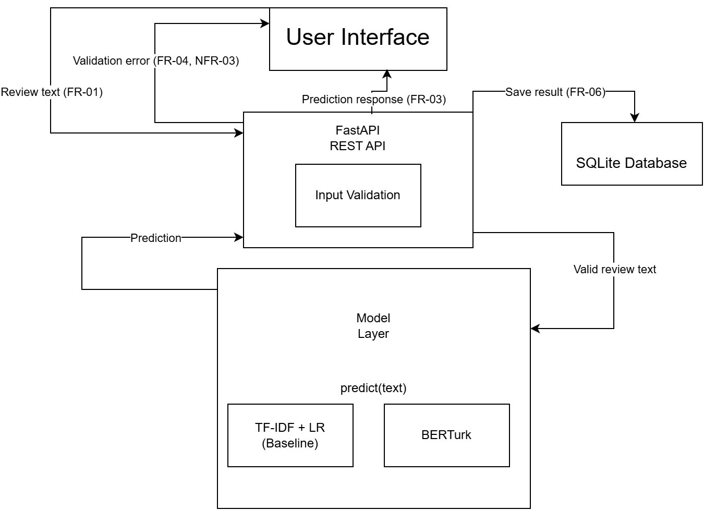

**Figure 3.1:** Proposed system architecture showing the main components and the flow of a review from input to prediction.

Figure 3.1 presents the proposed architecture. The User Interface sends the review text to the FastAPI REST API, where input validation checks whether the text is empty or contains only whitespace. Valid text is forwarded to the Model Layer, which produces a sentiment prediction through the common predict(text) interface. The prediction is returned to the API, which stores the result in the SQLite database and returns the predicted class to the User Interface. If validation fails, a validation error is returned to the user and the Model Layer is not called.

### 15.1 Component Responsibilities

| Component        | Responsibility / main input                                                                                                                                                         | Output / connection                                                                                                                                                              |
| ---------------- | ----------------------------------------------------------------------------------------------------------------------------------------------------------------------------------- | -------------------------------------------------------------------------------------------------------------------------------------------------------------------------------- |
| User Interface   | Allows the user to enter a Turkish customer review.                                                                                                                                 | Sends the review text to the FastAPI REST API and displays the predicted sentiment or validation error returned by the API.                                                      |
| FastAPI REST API | Receives review text from the User Interface and manages the classification request. Includes input validation to reject empty or whitespace-only text.                             | Sends valid text to the Model Layer; receives the predicted sentiment; stores the analysis result in SQLite; returns the prediction or a validation error to the User Interface. |
| Model Layer      | Processes valid Turkish review text using the selected sentiment classification model. Provides a common predict(text) interface for both TF-IDF + Logistic Regression and BERTurk. | Produces a predicted sentiment class (Positive, Neutral, or Negative) and sends it back to the FastAPI REST API.                                                                 |
| SQLite Database  | Stores analysis results received from the FastAPI REST API, including the review text, predicted sentiment class, and timestamp.                                                    | Stores the analysis records for later retrieval by the application.                                                                                                              |

### System Boundaries

The entire system will run locally on a single machine during development and demonstration. The User Interface, FastAPI REST API, Model Layer, and SQLite Database will operate within this local environment. The main external dependency is the pre-trained language model downloaded from Hugging Face; its availability and hosting are outside the project's direct control. Once downloaded, the model will run locally during application execution.

### 15.2 End-to-End Execution Scenario

| Step | Component                          | Input, operation, and output                                                                                                                      |
| ---- | ---------------------------------- | ------------------------------------------------------------------------------------------------------------------------------------------------- |
| 1    | User Interface                     | The user enters a Turkish customer review and submits it to the FastAPI REST API.                                                                 |
| 2    | FastAPI REST API                   | Receives the review text through the /predict endpoint and forwards it to input validation.                                                       |
| 3    | Input Validation (within FastAPI)  | Checks whether the review is empty or contains only whitespace. If valid, forwards the text to the Model Layer.                                   |
| 4    | Model Layer                        | Processes the review using the selected classification model through the common predict(text) interface and returns a sentiment class to the API. |
| 5    | FastAPI REST API / SQLite Database | Receives the predicted sentiment and stores the review text, predicted class, and timestamp in SQLite.                                            |
| 6    | FastAPI REST API / User Interface  | Returns the prediction as an API response. The User Interface displays the predicted sentiment to the user.                                       |

### Example API Endpoint

**Endpoint:** `POST /predict`

Request body:

```json
{
  "text": "Ürün çok kaliteli ve hızlı teslim edildi."
}
```

Successful response (HTTP 200 OK):

```json
{
  "sentiment": "Positive"
}
```

The `sentiment` field can contain one of three values: Positive, Neutral, or Negative.

### Error Scenario: Empty Review Input

If the user submits an empty review or a review containing only whitespace, the FastAPI input validation mechanism rejects the request before it reaches the Model Layer.

Example request:

```json
{
  "text": "   "
}
```

Error response (HTTP 422 Unprocessable Entity):

```json
{
  "detail": "Review text cannot be empty."
}
```

In this scenario the Model Layer is not called, no sentiment prediction is generated, no analysis result is stored in SQLite, and the validation error is returned to the User Interface and displayed to the user.

## 16. Requirements-to-Design Mapping

| ID     | Requirement in my project                                                                                                    | Design response / component                                                                                                                                                |
| ------ | ---------------------------------------------------------------------------------------------------------------------------- | -------------------------------------------------------------------------------------------------------------------------------------------------------------------------- |
| FR-02  | Classify a Turkish customer review into three sentiment classes: Positive, Neutral, or Negative.                             | Model Layer, using a common predict(text) interface implemented by TF-IDF + Logistic Regression and BERTurk.                                                               |
| FR-04  | Reject empty or whitespace-only review input and display a clear validation message.                                         | FastAPI REST API, using input validation before forwarding the request to the Model Layer.                                                                                 |
| FR-06  | Store each analysis result in an SQLite database for later retrieval.                                                        | SQLite Database, connected to the FastAPI REST API to store the review text, predicted sentiment class, and timestamp.                                                     |
| NFR-01 | Return a sentiment prediction within 2 seconds for a single review of up to 500 characters, excluding initial model loading. | Model Layer and FastAPI REST API. The selected model will be loaded into memory and kept available for subsequent requests instead of being reloaded for every prediction. |
| NFR-02 | Achieve a macro-F1 score of at least 0.75 on a held-out test set containing all three sentiment classes.                     | Model Layer. Both classification models will be evaluated using the same held-out test set, and macro-F1 will guide model selection.                                       |

The macro-F1 value stated in NFR-02 is a project target rather than a measured result. The two-second limit in NFR-01 excludes the initial model loading time.

## 17. Technology Selection

### ADR-01: Database Selection — SQLite vs PostgreSQL

| Field              | Decision                                                                                                                                                                                                                                                                                                                                                                                                                                                                                                                                                                                                                                                                                                                                                             |
| ------------------ | -------------------------------------------------------------------------------------------------------------------------------------------------------------------------------------------------------------------------------------------------------------------------------------------------------------------------------------------------------------------------------------------------------------------------------------------------------------------------------------------------------------------------------------------------------------------------------------------------------------------------------------------------------------------------------------------------------------------------------------------------------------------- |
| Issue              | Which database technology should be used to store sentiment analysis results?                                                                                                                                                                                                                                                                                                                                                                                                                                                                                                                                                                                                                                                                                        |
| Selected option    | SQLite                                                                                                                                                                                                                                                                                                                                                                                                                                                                                                                                                                                                                                                                                                                                                               |
| Alternative        | PostgreSQL                                                                                                                                                                                                                                                                                                                                                                                                                                                                                                                                                                                                                                                                                                                                                           |
| Reason / trade-off | SQLite was selected because the project is a small-scale, locally running prototype with a limited number of users and a relatively small amount of analysis data. It does not require a separate database server, user or server configuration, or additional deployment infrastructure. This reduces setup complexity and allows the database to run directly within the application environment. PostgreSQL offers better support for concurrent users, larger workloads, and more complex database requirements. However, these capabilities are not essential for the current project scope. The main trade-off is that SQLite may become less suitable if the system needs to support many simultaneous users or significantly larger workloads in the future. |
| Reference          | https://www.sqlite.org/whentouse.html                                                                                                                                                                                                                                                                                                                                                                                                                                                                                                                                                                                                                                                                                                                                |

### ADR-02: Language Model Selection — BERTurk vs mBERT

| Field              | Decision                                                                                                                                                                                                                                                                                                                                                                                                                                                                                                                                                                                                                                                                                                                                                                                       |
| ------------------ | ---------------------------------------------------------------------------------------------------------------------------------------------------------------------------------------------------------------------------------------------------------------------------------------------------------------------------------------------------------------------------------------------------------------------------------------------------------------------------------------------------------------------------------------------------------------------------------------------------------------------------------------------------------------------------------------------------------------------------------------------------------------------------------------------- |
| Issue              | Which pre-trained language model should be selected for Turkish customer review sentiment classification?                                                                                                                                                                                                                                                                                                                                                                                                                                                                                                                                                                                                                                                                                      |
| Selected option    | BERTurk (Turkish-specific BERT model)                                                                                                                                                                                                                                                                                                                                                                                                                                                                                                                                                                                                                                                                                                                                                          |
| Alternative        | mBERT (Multilingual BERT)                                                                                                                                                                                                                                                                                                                                                                                                                                                                                                                                                                                                                                                                                                                                                                      |
| Reason / trade-off | BERTurk was selected because it is specifically pre-trained for Turkish and is better suited to learning Turkish linguistic structures and contextual features. İncidelen and Aydoğan (2025) compared Turkish-specific and multilingual language models for sentiment analysis using the TRSAv1 dataset. Their findings indicate that Turkish-specific models, particularly BERTurk, generally perform better than multilingual alternatives. mBERT supports multiple languages and may be more suitable for multilingual applications, but multilingual coverage is not required in this project. The trade-off is that BERTurk is specialized for Turkish, whereas mBERT offers broader language coverage. The final model performance will still be evaluated on the project's own dataset. |
| Reference          | https://doi.org/10.36222/ejt.1592448                                                                                                                                                                                                                                                                                                                                                                                                                                                                                                                                                                                                                                                                                                                                                           |

Selecting BERTurk at this stage is an initial technical choice supported by published research, not a conclusion based on this project's own experimental results. The final model selection will be verified using macro-F1 results obtained on the project's own dataset.

## 18. Design Decisions and Risks

| Risk                                                 | Potential impact                                                                                                                                                                                                                         | Mitigation / verification                                                                                                                                                                                                                                                                    |
| ---------------------------------------------------- | ---------------------------------------------------------------------------------------------------------------------------------------------------------------------------------------------------------------------------------------- | -------------------------------------------------------------------------------------------------------------------------------------------------------------------------------------------------------------------------------------------------------------------------------------------- |
| RISK-01: Difficulty distinguishing the Neutral class | Three-star reviews may contain mixed or ambiguous opinions, making it difficult for the model to distinguish Neutral sentiment from Positive or Negative sentiment. This may reduce classification performance, especially macro-F1.     | Inspect representative three-star reviews and evaluate class-wise precision, recall, and F1-score. Review the rating-to-sentiment mapping during preprocessing and examine misclassified examples.                                                                                           |
| RISK-02: Limited availability of free GPU resources  | Free GPU services may have usage limits or availability issues, delaying BERTurk fine-tuning and model evaluation.                                                                                                                       | Start with the TF-IDF + Logistic Regression baseline, monitor available GPU resources, and use smaller batch sizes or reduced training configurations if necessary. Verify that the baseline remains functional independently of GPU availability.                                           |
| RISK-03: Class imbalance                             | The dataset may contain significantly more 4- and 5-star reviews than 1-, 2-, and 3-star reviews. This may cause the model to favor the majority class (Positive) and perform poorly on minority classes, negatively affecting macro-F1. | Inspect the class distribution after mapping star ratings to sentiment labels. Apply class weights during model training or consider undersampling/oversampling if necessary. Evaluate per-class precision, recall, and F1-score, as well as macro-F1, using the original held-out test set. |

## 19. Data and Storage Design

### Input Data

The system accepts Turkish e-commerce customer reviews as text input. The dataset contains review texts and associated star ratings, which will be mapped to three sentiment classes during preprocessing.

### Data Storage

The application uses SQLite to store sentiment analysis results locally. The database contains one main table named `analysis_results`.

| Field           | Data type | Description                                                               |
| --------------- | --------- | ------------------------------------------------------------------------- |
| id              | INTEGER   | Unique identifier for each analysis record (Primary Key, Auto Increment). |
| review_text     | TEXT      | Original Turkish customer review submitted by the user.                   |
| predicted_class | TEXT      | Predicted sentiment class: Positive, Neutral, or Negative.                |
| timestamp       | DATETIME  | Date and time when the analysis was performed.                            |

### External Dependencies

- Hugging Face: used to download the pre-trained BERTurk model and tokenizer.
- Python libraries: used for data processing, model training, and API development.
- SQLite: used for local data storage.

### Privacy and Security Considerations

Customer reviews may contain personal or identifying information. The prototype runs locally and does not require user accounts or cloud-based storage. Only the information necessary for sentiment analysis and result storage will be retained. Sensitive personal information will not be intentionally collected, and the dataset usage conditions will be checked before use.

## 20. References

### ACADEMIC REFERENCES

1. Altinok, D. (2025). Introducing TrGLUE and SentiTurca: A Comprehensive Benchmark for Turkish General Language Understanding and Sentiment Analysis. arXiv:2512.22100. https://arxiv.org/abs/2512.22100

   This paper introduces benchmarks for evaluating Turkish language models on natural language understanding and sentiment analysis tasks. I learned that these benchmarks can help researchers compare different models using standardized evaluation methods. I can use this study to guide my model evaluation and investigate whether its published results are comparable to my own experiments.

2. İncidelen, M., & Aydoğan, M. (2025). Sentiment Analysis in Turkish Using Language Models: A Comparative Study. European Journal of Technique, 15(1), 68–74. https://doi.org/10.36222/ejt.1592448

   This study compares several language models fine-tuned on 150,000 Turkish e-commerce reviews from the TRSAv1 dataset. It reports performance metrics such as accuracy and F1-score, providing a useful reference for selecting a Turkish language model and comparing it with my TF-IDF and Logistic Regression baseline.

3. Arzu, M., & Aydoğan, M. (2023). Comparative Analysis of Transformers Based Architectures for Turkish Sentiment Classification. Journal of Computer Science, IDAP-2023, 1-6. https://doi.org/10.53070/bbd.1350405

   I learned that Transformer-based models can effectively classify Turkish customer reviews into positive, neutral, and negative categories. I will use this study to understand how BERTurk-based architectures perform in Turkish sentiment classification and to support my model selection and evaluation process.

### TECHNICAL REFERENCES

4. Hugging Face. Transformers Documentation. https://huggingface.co/docs/transformers (Accessed: October 2026)

   This documentation explains how to load pretrained language models, fine-tune them for text classification, and evaluate their predictions. I will use it to implement and evaluate the fine-tuned Turkish encoder in my customer review analysis service.

5. Ramírez, S. FastAPI Documentation. https://fastapi.tiangolo.com/ (Accessed: October 2026)

   This documentation explains how to build APIs, validate input data, and test application endpoints. I will use it to develop the API that receives customer reviews, sends them to the sentiment analysis model, and returns the prediction to the user.

6. scikit-learn. scikit-learn: Machine Learning in Python. https://scikit-learn.org/stable/ (Accessed: November 2026)

   I learned that scikit-learn provides tools for text feature extraction, machine learning model training, and model evaluation. I will use this library to build my TF-IDF and Logistic Regression baseline model and evaluate its performance using metrics such as accuracy and F1-score.

## 21. Implementation Overview

This chapter documents the first working prototype developed during Week 4. The prototype implements the core classification workflow described in Section 15: a Turkish customer review is submitted through the REST API, validated, classified by the baseline model, and the predicted sentiment class is returned as a JSON response.

The prototype satisfies FR-01 (accepting review text), FR-02 (three-class classification), FR-03 (returning the predicted class), FR-04 (rejecting empty input), and FR-05 (exposing the functionality through a FastAPI REST API). FR-06 (storing results in SQLite) is not yet implemented and is planned for a later stage. The fine-tuned BERTurk model and the user interface are also outside the scope of this prototype and are scheduled for Week 5.

## 22. Development Environment and Technologies

| Component               | Technology / version                  | Role and reason for selection                                                                                        |
| ----------------------- | ------------------------------------- | -------------------------------------------------------------------------------------------------------------------- |
| Language                | Python 3.11.7                         | Main development language; required by the selected NLP and machine learning libraries.                              |
| Machine learning        | scikit-learn 1.9.1                    | Provides TfidfVectorizer and LogisticRegression used in the baseline model, together with evaluation metrics.        |
| Data handling           | pandas 3.1.0, datasets 5.1.0          | Loading the MüşteriYorumları dataset from Hugging Face and converting it into DataFrames for preprocessing.          |
| API framework           | FastAPI 0.162.0, uvicorn 0.54.0       | Implements the REST API and provides automatic interactive documentation used for manual verification.               |
| Model persistence       | joblib 1.6.0                          | Saves and loads the trained pipeline so that the API does not retrain the model at startup.                          |
| Development environment | Visual Studio Code, Jupyter notebooks | Notebooks are used for data exploration and model experiments; application code is kept in `src/` as Python modules. |
| Version control         | Git and GitHub                        | Development history and technical evidence.                                                                          |

The project uses a Python virtual environment (`.venv`), and all dependencies are recorded in `requirements.txt`.

## 23. Technical Challenges and Solutions

### 23.1 Package Installation Failure

**Problem:** While installing the required packages, pip could not resolve a compatible set of versions and progressively tried older scikit-learn releases. It eventually attempted to build a version with no prebuilt Windows wheel from source, which failed with the error "Microsoft Visual C++ 14.0 or greater is required".

**Diagnosis:** Reading the full error output showed that the installed pip version (23.2.1) was unable to resolve the dependency set and had fallen back to source builds.

**Solution:** Instead of installing C++ build tools, I upgraded pip to version 26.2.2. The updated version located compatible prebuilt Windows wheels and completed the installation without any compilation step.

### 23.2 API Startup Import Errors

**Problem:** When starting the FastAPI application with uvicorn, the server first reported "Attribute app not found in module api" and then, after the file was corrected, "cannot import name BaselineModel from model".

**Diagnosis:** The first error indicated that `src/api.py` did not yet contain the `app` object uvicorn expects. The second error showed that `src/model.py` did not contain the `BaselineModel` class referenced by the API module.

**Solution:** I completed both module files with the required definitions. Because uvicorn was running with the `--reload` flag, the server restarted automatically after each save and finally reported "Application startup complete".

### 23.3 Low F1-Score for the Neutral Class

**Problem:** In the baseline evaluation, the Neutral class reached an F1-score of 0.562, considerably lower than Negative (0.781) and Positive (0.864).

**Diagnosis:** Reviewing the per-class metrics showed that Neutral had the lowest precision (0.496), meaning that roughly half of the reviews predicted as Neutral belonged to another class. The Neutral class is also the smallest in the dataset (17.4% of the training data).

**Solution:** This result confirmed two risks identified during Week 3: RISK-01 (difficulty distinguishing the Neutral class) and RISK-03 (class imbalance). The `class_weight="balanced"` setting was already applied to the Logistic Regression model as a mitigation. Improving Neutral-class performance is recorded as one of the objectives for the fine-tuned model in Week 5.

## 24. Prototype Implementation

**Feature:** Sentiment classification of a Turkish customer review through a REST API

**Requirement IDs:** FR-01, FR-02, FR-03, FR-04, FR-05

**Input:** A JSON object containing a single `text` field with the review to be classified.

**Output:** A JSON object containing a single `sentiment` field with one of three values: Positive, Neutral, or Negative.

**Processing:** The request reaches the `/predict` endpoint defined in `src/api.py`. FastAPI validates the request body against the `ReviewRequest` model. The endpoint then checks whether the text is empty or contains only whitespace; if so, it raises an HTTP 422 error and the model is not called. Valid text is passed to the `predict()` method of the `BaselineModel` class in `src/model.py`, which applies the saved TF-IDF and Logistic Regression pipeline and returns the predicted class. The result is returned to the client as a `PredictionResponse`.

**Relationship to the architecture:** The implementation follows the component structure described in Section 15. The `BaselineModel` class provides the common `predict(text)` interface defined in the architecture, which allows the fine-tuned BERTurk model to replace the baseline in Week 5 without modifying the API layer. The model is loaded once at application startup rather than per request, as specified in the design response for NFR-01.

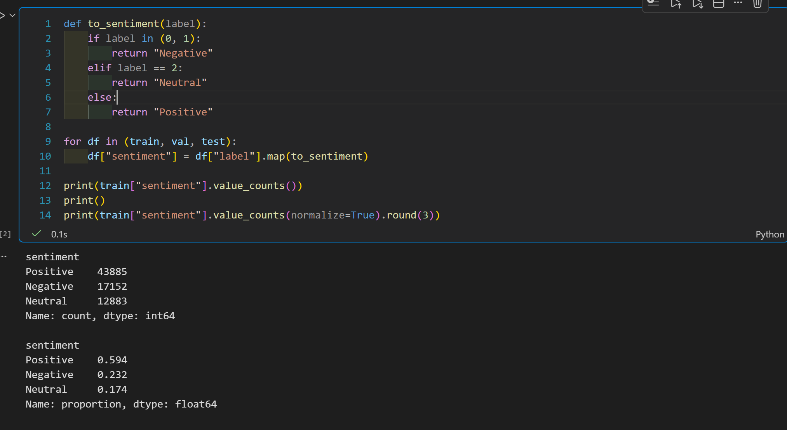

**Figure 4.1:** Mapping of star ratings to three sentiment classes and the resulting class distribution in the training set.

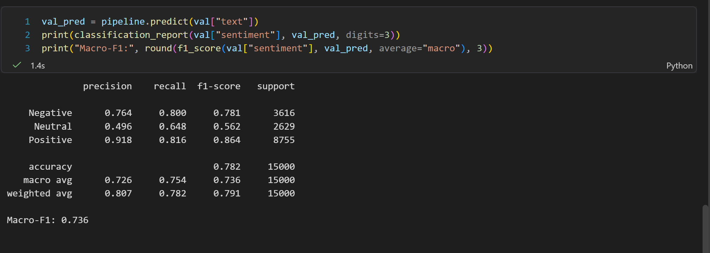

**Figure 4.2:** Classification report of the TF-IDF + Logistic Regression baseline on the validation set, showing per-class metrics and a macro-F1 of 0.736.

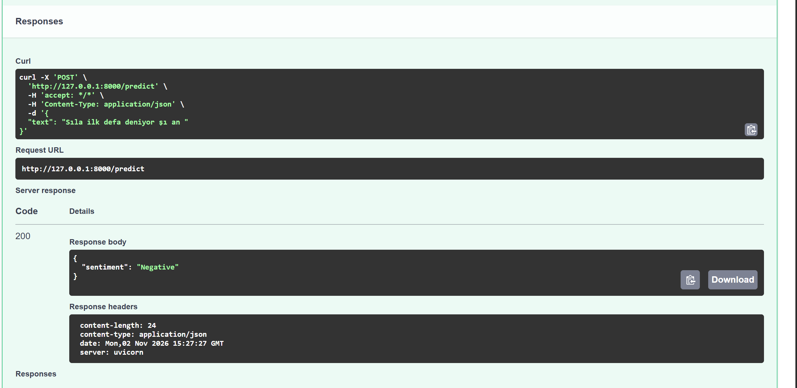

**Figure 4.3:** Successful prediction through the FastAPI interactive documentation, returning HTTP 200 with the predicted sentiment class.

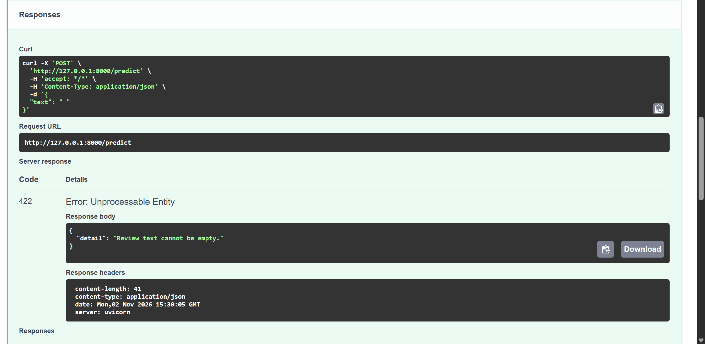

**Figure 4.4:** Validation error for whitespace-only input, returning HTTP 422 without calling the model.

### Preliminary Verification

| ID  | Input                                        | Expected                | Actual                                   | Status |
| --- | -------------------------------------------- | ----------------------- | ---------------------------------------- | ------ |
| P01 | "Ürün çok kaliteli ve hızlı teslim edildi."  | Positive                | Positive                                 | Pass   |
| P02 | "Berbat bir ürün, kesinlikle almayın."       | Negative                | Negative                                 | Pass   |
| P03 | "Fena değil ama beklediğim gibi de çıkmadı." | Neutral                 | Neutral                                  | Pass   |
| P04 | " " (whitespace only)                        | HTTP 422, no prediction | HTTP 422, "Review text cannot be empty." | Pass   |

These preliminary checks do not replace the full testing and validation work scheduled for Week 6.

## 25. Development Process — Stage 1

| Field                        | Entry                                                                                                                                                                                      |
| ---------------------------- | ------------------------------------------------------------------------------------------------------------------------------------------------------------------------------------------ |
| Date                         | 02.11.2026                                                                                                                                                                                 |
| Objective                    | Develop the first end-to-end prototype: load and preprocess the dataset, train a baseline model, and expose it through a REST API.                                                         |
| Implemented functionality    | Dataset loading and label mapping, TF-IDF + Logistic Regression baseline, FastAPI `/predict` endpoint with input validation.                                                               |
| Important technical decision | Kept the model layer separate from the API by using a consistent prediction interface. This will allow BERTurk to replace the baseline model in Week 5 without changing the API structure. |
| Problem encountered          | Encountered package installation issues and import errors while setting up the development environment and integrating the baseline model with FastAPI.                                    |
| Solution attempted           | Updated pip to resolve package compatibility issues, corrected module imports and class references, and tested the `/predict` endpoint with both valid and invalid inputs.                 |
| Related GitHub commit        | 2f3aca6 — feat: implement TF-IDF baseline and FastAPI prediction endpoint                                                                                                                  |
| Screenshot / evidence        | evidence/week-04/01-dataset-exploration.png, 02-baseline-results.png, 03-api-success.png, 04-api-validation-error.png                                                                      |
| Next development step        | Fine-tune BERTurk and integrate it behind the same prediction interface (Week 5).                                                                                                          |

## 26. Current Limitations and Next Steps (End of Week 4)

At the end of Week 4, the prototype had the following limitations. Sections 27–36 document how these were addressed during Week 5:

- The fine-tuned BERTurk model has not yet been trained; only the TF-IDF and Logistic Regression baseline is available.
- The baseline reached a macro-F1 of 0.736 on the validation set, below the 0.75 target defined in NFR-02.
- FR-06 (storing analysis results in SQLite) is not implemented.
- No user interface exists; the API is accessed through the interactive documentation page.
- No automated tests have been written; verification was performed manually.
- The model was trained on product reviews and its behaviour on out-of-domain text is not defined.

**Planned work for Week 5:** Fine-tune BERTurk for three-class Turkish sentiment classification and integrate it into the existing FastAPI service by replacing the baseline model behind the same `predict(text)` interface, then verify that the API continues to work with the new model.

## 27. Week 5 Implementation Overview

Week 5 extended the Week 4 prototype through two development stages. Stage 2 completed the result storage requirement and improved the internal organisation of the source code. Stage 3 replaced the baseline classifier with a fine-tuned BERTurk model, which was the main engineering milestone of the project.

Together these stages changed the status of three requirements. FR-06 (storing analysis results) moved from "not implemented" to implemented and verifiable. NFR-02 (macro-F1 of at least 0.75 on a held-out test set), which the baseline had not met, is now satisfied. NFR-03 (input validation) was extended with a second invalid-input condition.

## 28. Development Stage 2 — Result Storage and Code Organisation

**Requirement IDs:** FR-06, NFR-03

Stage 2 implemented persistent storage of analysis results. A new module, `src/database.py`, creates the `analysis_results` table described in Section 19 and provides two operations: `save_result()` to store a prediction and `get_recent_results()` to read stored records back. The API calls the first after every successful prediction and exposes the second through a new `GET /history` endpoint.

The storage function returns a boolean rather than raising an exception when the database is unavailable. This was a deliberate decision: storing a result is secondary to answering the user, so a storage failure should not prevent a prediction from being returned. The response includes a `stored` field so that the caller can see whether the record was written. This is consistent with the priority assigned to FR-06 in Section 9, where it is marked "Should" rather than "Must".

All SQL statements use parameter placeholders instead of string formatting, so review text containing quotation marks or SQL keywords cannot alter the query.

Stage 2 also introduced `src/config.py`, which collects file paths, sentiment class names and input limits that were previously spread across modules. Two further quality improvements were made: `BaselineModel` now raises a descriptive `ModelLoadError` when the model file is missing instead of failing with an unclear library error, and the API rejects review text longer than the configured maximum, giving a second invalid-input condition alongside empty input.

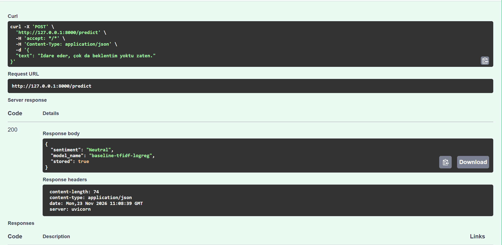

**Figure 5.1:** A prediction request returning the sentiment class, the active model name and confirmation that the result was stored.

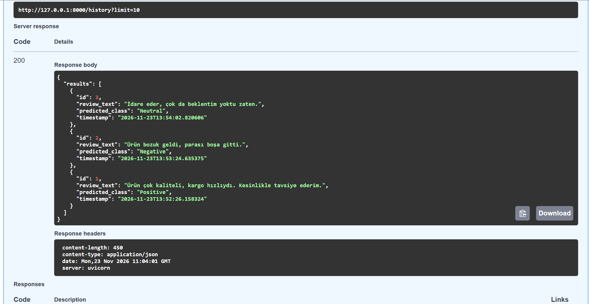

**Figure 5.2:** The `/history` endpoint returning three stored analysis records with their identifiers, predicted classes and timestamps. This output demonstrates that the database write and read operations both function, rather than only showing that the endpoint returns a response.

## 29. Development Stage 3 — Fine-Tuned BERTurk Integration

**Requirement IDs:** FR-02, NFR-02

Stage 3 fine-tuned the BERTurk model selected in ADR-02 and integrated it into the running service.

Training was performed in a Kaggle notebook using a Tesla T4 GPU. The same dataset splits used for the baseline were loaded, and the same star-rating-to-sentiment mapping was applied, so that the two models remain comparable. Review texts were tokenised with the BERTurk tokenizer at a maximum length of 128 tokens, which covers the large majority of customer reviews in this dataset.

The training loop was implemented directly in PyTorch rather than through a high-level training wrapper. Each step moves a batch to the GPU, computes predictions, measures the error with a weighted cross-entropy loss, propagates the gradients backward, updates the model parameters and advances the learning-rate schedule. Mixed-precision arithmetic was used to shorten training time.

Class weights were applied to the loss function using the same balancing formula as the baseline model, assigning a weight of 1.913 to Neutral, 1.437 to Negative and 0.561 to Positive. This addresses RISK-03, the class imbalance identified in Week 3: an error on a Neutral example is penalised roughly three times more heavily than an error on a Positive one.

The model was trained for two epochs with a learning rate of 2e-5 and a batch size of 32. Average training loss decreased from 0.5671 in the first epoch to 0.4485 in the second.

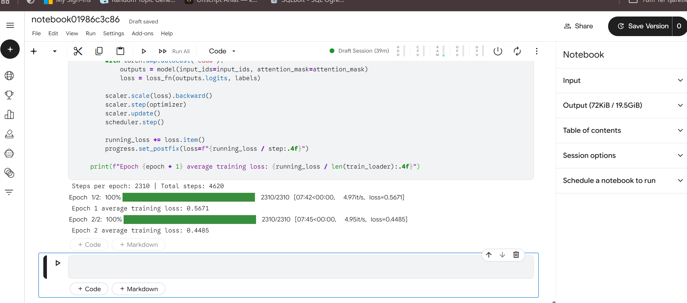

**Figure 5.3:** Fine-tuning progress over two epochs, showing the decrease in average training loss.

Integration required no change to the API layer. A second class, `BERTurkModel`, was added to `src/model.py` implementing the same `predict(text) -> str` interface as `BaselineModel`, and a `load_active_model()` function returns whichever model is named in `config.ACTIVE_MODEL`. Switching the service from the baseline to the fine-tuned model is therefore a one-line configuration change.

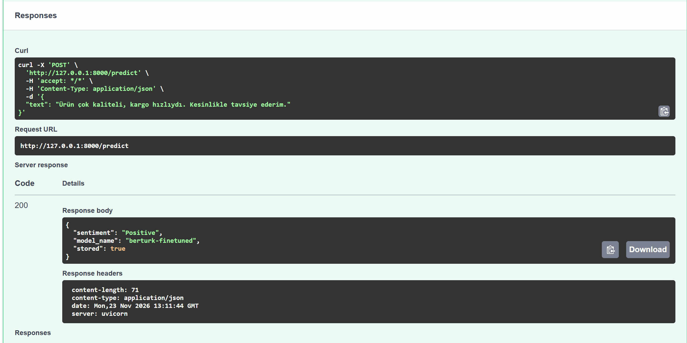

**Figure 5.4:** The same `/predict` endpoint after switching the active model, now reporting `berturk-finetuned` as the model name. The endpoint code, validation logic and storage behaviour are unchanged.

## 30. Model Comparison: Baseline and Fine-Tuned BERTurk

Both models were evaluated on the same validation set used in Week 4.

| Class        | Baseline F1 | BERTurk F1 | Difference |
| ------------ | ----------- | ---------- | ---------- |
| Negative     | 0.781       | 0.838      | +0.057     |
| Neutral      | 0.562       | 0.630      | +0.068     |
| Positive     | 0.864       | 0.898      | +0.034     |
| **Macro-F1** | **0.736**   | **0.788**  | **+0.052** |

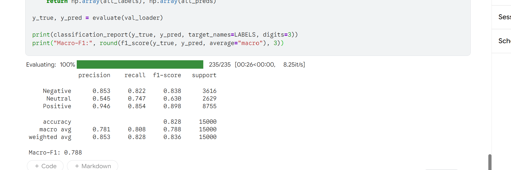

**Figure 5.5:** Classification report of the fine-tuned BERTurk model on the validation set.

The fine-tuned model was then evaluated on the test set, which was not used during training or model selection.

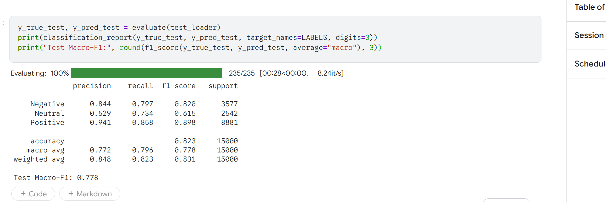

**Figure 5.6:** Classification report on the held-out test set, reaching a macro-F1 of 0.778.

Three observations follow from these results.

NFR-02 is satisfied. The requirement specifies a macro-F1 of at least 0.75 on a held-out test set; the fine-tuned model reached 0.778. The baseline had fallen short at 0.736.

The largest improvement is in the Neutral class, which gained 0.068 F1 points. This is the class identified as problematic in RISK-01, and the improvement is consistent with the expectation that a contextual language model handles mixed expressions better than a bag-of-words representation.

Neutral nevertheless remains the weakest class, with a test precision of 0.529. Roughly half of the reviews predicted as Neutral belong to another class. RISK-01 has been reduced but not resolved, and this remains a limitation of the current system.

The difference between validation macro-F1 (0.788) and test macro-F1 (0.778) is small, which suggests the model generalises rather than having memorised the training data.

## 31. Updated System Architecture

The implemented system follows the architecture presented in Figure 3.1, with two additions. The table below compares the planned design with the current state.

| Component            | Original design (Week 3)                                           | Current state                                                                                                                                                         |
| -------------------- | ------------------------------------------------------------------ | --------------------------------------------------------------------------------------------------------------------------------------------------------------------- |
| User Interface       | Planned as a simple web page for entering reviews                  | Not implemented; the FastAPI interactive documentation is used for demonstration. Deferred to a later week.                                                           |
| FastAPI REST API     | Planned with a single `/predict` endpoint                          | Implemented as designed, plus a `/history` endpoint that was not in the original design. Added so that stored results can be retrieved, which makes FR-06 verifiable. |
| Model Layer          | Planned as a common `predict(text)` interface shared by two models | Implemented as designed. Both `BaselineModel` and `BERTurkModel` expose the same method, and `load_active_model()` selects between them.                              |
| SQLite Database      | Planned to store review text, predicted class and timestamp        | Implemented as designed, using the table structure described in Section 19.                                                                                           |
| Configuration module | Not present in the original design                                 | Added as `src/config.py`. File paths, class names, input limits and the active model selection are no longer spread across modules.                                   |

The central design decision of Week 3 — placing the model behind a common interface — was validated in practice during Stage 3. Replacing the baseline with the fine-tuned model required no modification to the API layer, the validation logic or the storage code.

## 32. Updated Technology Stack

The following components were added to the stack described in Section 22.

| Component            | Technology / version                           | Role and reason for selection                                                                                                                                     |
| -------------------- | ---------------------------------------------- | ----------------------------------------------------------------------------------------------------------------------------------------------------------------- |
| Deep learning        | PyTorch 2.15.0 (CPU build)                     | Runs the fine-tuned transformer model during inference. The CPU build is used locally because predictions are made one review at a time and do not require a GPU. |
| Transformer models   | Transformers 5.24.0 (local), 5.20.2 (training) | Loads the BERTurk tokenizer and the fine-tuned classification model.                                                                                              |
| Training environment | Kaggle Notebooks, Tesla T4 GPU                 | Provides free GPU access for fine-tuning. Used instead of a local machine, which has no suitable GPU.                                                             |
| Storage              | SQLite (Python standard library)               | Stores analysis results locally, as decided in ADR-01. Requires no separate server process.                                                                       |

## 33. Technical Challenges (Week 5)

### 33.1 Google Colab Storage Quota

**Problem:** When attempting to create a Colab notebook for fine-tuning, Google Colab returned an error stating that the Drive storage quota had been exceeded (`GapiError: The user has exceeded their Drive storage quota`). Because Colab stores notebooks in Google Drive, no new notebook could be created.

**Solution:** Rather than freeing space in Drive, I moved the training work to Kaggle Notebooks, which provides free GPU access and does not depend on Drive storage. This also confirmed the mitigation planned for RISK-02: keeping an alternative GPU environment available.

### 33.2 Model Download from a Draft Session

**Problem:** After training, the exported model archive appeared in the Kaggle Output panel but could not be downloaded directly. The cause was that the notebook was still running as a draft session, where output downloads are not permitted.

**Solution:** I created a saved version of the notebook. In the Save Version dialog, the "Save Output" option under Advanced Settings was set to never save output for a Quick Save, so I changed it. Once the version completed successfully, the model archive could be downloaded from the version page.

### 33.3 Transformers Major Version Difference

**Problem:** The Kaggle environment provided Transformers 5.20.2. Because this is a major version change, the parameters of the high-level `Trainer` API could differ from the 4.x documentation, creating a risk of incompatibility during training.

**Solution:** Instead of using the `Trainer` class, I implemented the fine-tuning loop manually in PyTorch. This avoids dependence on API changes and gives direct control over loss computation, backpropagation, the optimizer step and the learning-rate scheduler, which also makes the training process easier to explain.

## 34. Development Process — Stage 2

| Field                     | Entry                                                                                                                                                                                              |
| ------------------------- | -------------------------------------------------------------------------------------------------------------------------------------------------------------------------------------------------- |
| Date                      | 23.11.2026                                                                                                                                                                                         |
| Objective                 | Implement persistent storage of analysis results and improve code organisation.                                                                                                                    |
| Requirement IDs           | FR-06, NFR-03                                                                                                                                                                                      |
| Implemented functionality | SQLite storage of review text, predicted class and timestamp; `GET /history` endpoint for retrieval; centralised configuration; descriptive model-loading errors; maximum input length validation. |
| Main files / modules      | `src/database.py` (new), `src/config.py` (new), `src/api.py`, `src/model.py`                                                                                                                       |
| Engineering decision      | Storage failures return a status flag instead of raising an exception, so that a database problem cannot prevent a prediction from being returned to the user.                                     |
| Technical problem         | FR-06 required results to be stored "for later retrieval", but there was no way to confirm that records had actually been written.                                                                 |
| Solution                  | Added the `/history` endpoint, which reads stored records back and makes the storage operation verifiable rather than assumed.                                                                     |
| Screenshot / evidence     | evidence/week-05/01-predict-with-storage.png, 02-history-endpoint.png                                                                                                                              |
| GitHub commit             | 1094972 — feat: add SQLite storage and history endpoint (FR-06)                                                                                                                                    |
| Next step                 | Fine-tune BERTurk and integrate it behind the existing model interface.                                                                                                                            |

## 35. Development Process — Stage 3

| Field                     | Entry                                                                                                                                                                                                 |
| ------------------------- | ----------------------------------------------------------------------------------------------------------------------------------------------------------------------------------------------------- |
| Date                      | 23.11.2026                                                                                                                                                                                            |
| Objective                 | Fine-tune BERTurk for three-class Turkish sentiment classification and integrate it into the running service.                                                                                         |
| Requirement IDs           | FR-02, NFR-02                                                                                                                                                                                         |
| Implemented functionality | Fine-tuned BERTurk model trained on the project dataset; `BERTurkModel` class implementing the shared prediction interface; configuration-driven model selection.                                     |
| Main files / modules      | `notebooks/berturk_finetuning.ipynb` (new), `src/model.py`, `src/config.py`                                                                                                                           |
| Engineering decision      | The fine-tuned model was added as a second implementation of the existing `predict(text)` interface rather than by modifying the API, so the active model can be changed through configuration alone. |
| Technical problem         | The local machine has no suitable GPU, and the first GPU environment attempted (Google Colab) could not be used because of a storage quota limit.                                                     |
| Solution                  | Training was moved to Kaggle Notebooks with a Tesla T4 GPU; the exported model was downloaded and placed in the local `models/` directory.                                                            |
| Screenshot / evidence     | evidence/week-05/03-gpu-availability.png, 04-berturk-training.png, 05-berturk-evaluation.png, 06-berturk-test-evaluation.png, 07-api-with-berturk.png                                                 |
| GitHub commit             | 2f94b23 — feat: integrate fine-tuned BERTurk behind the shared model interface                                                                                                                        |
| Next step                 | Write automated tests with pytest and produce a systematic comparison of both models (Week 6).                                                                                                        |

## 36. Current Limitations and Next Steps (Week 5)

The following limitations remain after Week 5:

- Neutral remains the weakest class, with a test precision of 0.529. RISK-01 is reduced but not resolved.
- No user interface exists; the service is demonstrated through the interactive API documentation.
- No automated tests have been written; all verification so far has been manual.
- The trained model file is not stored in the repository because of its size (423 MB). It is regenerated by running `notebooks/berturk_finetuning.ipynb`.
- Inference runs on CPU locally, which is adequate for single predictions but would not support high request volumes.

**Planned work for Week 6:** Implement automated tests with pytest covering the API endpoints, input validation and the model interface, and produce a systematic evaluation comparing both models on the same held-out test set.

## 37. Testing Methodology

Week 6 introduced systematic testing. Verification until this point had been manual: a request was sent through the interactive API documentation and the response was inspected by eye. That approach confirms that a feature works once, but it does not detect a regression introduced later, and it is not reproducible by anyone else.

### 37.1 Selected Testing Methods

Four testing methods were selected, each tied to a specific component or requirement of the system.

**Unit tests** verify that the SQLite database operations behave correctly — that saving a record and retrieving the stored history return the expected results (FR-06).

**API tests** verify that the FastAPI endpoints respond correctly, return prediction results, and communicate properly with the database layer (FR-01, FR-02, FR-03, FR-05).

**Boundary tests** cover cases such as empty text, whitespace-only text and other invalid input, and confirm that the system does not produce a prediction for them (FR-04, NFR-03).

**Model evaluation** compares the baseline and the fine-tuned model, using macro-F1 and per-class results (NFR-02).

User interface testing, load testing and security testing were left outside the scope at this stage. The priority of the project is the correctness of the core classification function and the API, rather than the visual quality of an interface or performance under heavy traffic. The system is also not yet running in a production environment, so these tests were deferred to later development stages.

### 37.2 Tools and Environment

| Item             | Detail                                                           |
| ---------------- | ---------------------------------------------------------------- |
| Test framework   | pytest 9.2.0                                                     |
| HTTP test client | FastAPI `TestClient`, which uses httpx                           |
| Environment      | Windows 11, Python 3.11.7, project virtual environment (`.venv`) |
| Command          | `pytest -v`, executed from the project root                      |
| Test location    | `tests/` — `conftest.py`, `test_database.py`, `test_api.py`      |

### 37.3 Test Case Design

Test cases were designed around three considerations.

_Normal cases_ confirm that a correct request produces the expected result: a valid Turkish review returns one of the three sentiment classes and the result is stored.

_Invalid cases_ confirm that the system refuses input it cannot process: empty text, whitespace-only text, a missing field, and a `limit` parameter outside the permitted range.

_Boundary cases_ test the exact edges of the accepted range rather than values far outside it. Review text of exactly `MAX_REVIEW_LENGTH` characters must be accepted, and text one character longer must be rejected. The `/history` limit must accept 1 and 100 and reject 0 and 101.

One design decision concerns the model. Loading the fine-tuned model takes several seconds and 423 MB of memory, and the API tests do not depend on the model's accuracy — they verify validation, storage and response format. A lightweight stand-in class is therefore supplied in place of the real model through FastAPI's dependency injection. Model accuracy is measured separately on the held-out test set, as described in Section 40. This separation keeps the suite fast: 21 tests complete in under half a second.

## 38. Validation

Each test is linked to a requirement defined in Week 2. The table below shows which requirement each group of tests validates.

| Requirement                                               | Validated by                | Tests                  |
| --------------------------------------------------------- | --------------------------- | ---------------------- |
| FR-01 — accept a Turkish review as text input             | API tests                   | T07, T08, T09          |
| FR-02 — classify into three sentiment classes             | API tests, model evaluation | T07, Section 40        |
| FR-03 — return the predicted class to the user            | API tests                   | T07, T08               |
| FR-04 — reject empty or whitespace-only input             | Boundary tests              | T10, T11, T12, T13     |
| FR-05 — expose the functionality through a REST API       | API tests                   | T07–T21                |
| FR-06 — store each analysis result for later retrieval    | Unit tests, API tests       | T01–T06, T16, T17, T18 |
| NFR-02 — macro-F1 of at least 0.75 on a held-out test set | Model evaluation            | Section 40             |
| NFR-03 — return a validation error without classifying    | Boundary tests              | T10, T11, T13, T15     |

The most critical test for this system is the boundary test that verifies the API rejects empty or whitespace-only input. One of the system's core requirements is to validate the text received from the user before sending it to classification. Passing empty input to the model would produce a meaningless prediction and an unnecessary database record. This test confirms that the system catches the invalid input before the model is called, produces no prediction, and writes nothing to the database. The API returning the expected HTTP 422 error shows that this behaviour is working as specified.

T13 is the test that makes this verifiable rather than assumed: it submits invalid input and then checks the history endpoint to confirm that no record was created.

## 39. Testing Results

All 21 tests pass. The suite completes in 0.48 seconds.

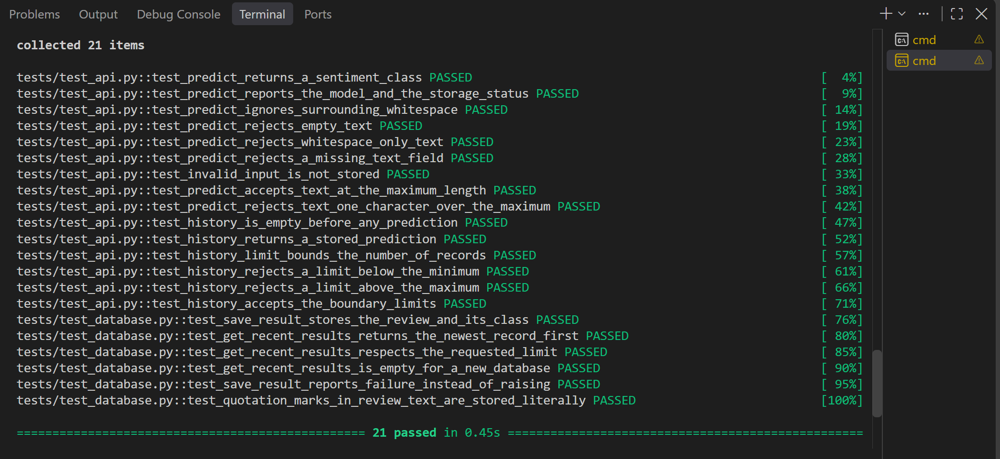

**Figure 6.1:** Output of `pytest -v`, showing all 21 test cases and their status.

### 39.1 Test Case Records

| ID  | Component / objective                     | Input                                       | Expected result                                             | Actual result | Status |
| --- | ----------------------------------------- | ------------------------------------------- | ----------------------------------------------------------- | ------------- | ------ |
| T01 | Storage — a saved result can be read back | "Ürün çok kaliteli.", Positive              | Record stored with the same text, class and a timestamp     | As expected   | Pass   |
| T02 | Storage — ordering of history             | Two records saved in sequence               | Newest record returned first                                | As expected   | Pass   |
| T03 | Storage — limit applied                   | 5 records, `limit=3`                        | 3 records returned                                          | As expected   | Pass   |
| T04 | Storage — empty database                  | No records                                  | Empty list returned                                         | As expected   | Pass   |
| T05 | Storage — failure handling                | Unwritable database path                    | `False` returned, no exception raised                       | As expected   | Pass   |
| T06 | Storage — SQL injection safety            | Text containing `'` and `DROP TABLE`        | Text stored literally as data                               | As expected   | Pass   |
| T07 | `/predict` — valid review                 | "Ürün çok kaliteli ve hızlı teslim edildi." | HTTP 200, one of the three sentiment classes                | As expected   | Pass   |
| T08 | `/predict` — response fields              | Valid review                                | Response names the active model and reports `stored: true`  | As expected   | Pass   |
| T09 | `/predict` — whitespace trimming          | " Ürün iyi. "                               | Stored text has no leading or trailing spaces               | As expected   | Pass   |
| T10 | `/predict` — empty input                  | `""`                                        | HTTP 422, model not called                                  | As expected   | Pass   |
| T11 | `/predict` — whitespace-only input        | `"     "`                                   | HTTP 422, model not called                                  | As expected   | Pass   |
| T12 | `/predict` — missing field                | `{}`                                        | HTTP 422                                                    | As expected   | Pass   |
| T13 | `/predict` — invalid input is not stored  | `"   "` then `GET /history`                 | History remains empty                                       | As expected   | Pass   |
| T14 | `/predict` — maximum length boundary      | 5000 characters                             | HTTP 200                                                    | As expected   | Pass   |
| T15 | `/predict` — above maximum boundary       | 5001 characters                             | HTTP 422                                                    | As expected   | Pass   |
| T16 | `/history` — empty database               | No prior prediction                         | HTTP 200, empty result list                                 | As expected   | Pass   |
| T17 | `/history` — stored prediction appears    | One prediction made                         | Record returned with the same review text and a valid class | As expected   | Pass   |
| T18 | `/history` — limit applied                | 4 predictions, `limit=2`                    | 2 records returned                                          | As expected   | Pass   |
| T19 | `/history` — limit below minimum          | `limit=0`                                   | HTTP 422                                                    | As expected   | Pass   |
| T20 | `/history` — limit above maximum          | `limit=101`                                 | HTTP 422                                                    | As expected   | Pass   |
| T21 | `/history` — limit boundaries             | `limit=1` and `limit=100`                   | HTTP 200 for both                                           | As expected   | Pass   |

The full output is stored in `evidence/week-06/pytest-output.txt`.

### 39.2 Problems Found and Corrected

Writing the tests revealed two architectural problems in code that was already working.

**The model was loaded at import time.** The model was created at the top level of the application module, so importing the module for a test also loaded the model. This made the tests difficult to run, because the 423 MB fine-tuned model had to be loaded before any test could execute. I restructured the model loading so that it is more controlled and the code became testable: the model is now provided through a function that endpoints receive as a dependency.

This change preserves the behaviour required by NFR-01. The model is still loaded once when the application starts, not on every request; the first call to the loading function stores the model and later calls return the same instance. What changed is where the loading decision lives, not how often loading happens.

**`on_event` was deprecated.** The test run produced a `DeprecationWarning` stating that FastAPI's `on_event` hook is deprecated and that lifespan event handlers should be used instead. I replaced it with the modern `lifespan` approach, which manages the application's startup and shutdown steps in one place and keeps the application life cycle better organised.

Both changes were verified by rerunning the same test suite. After the correction the suite reports 21 passed with no warnings.

|            | Before                                       | After               |
| ---------- | -------------------------------------------- | ------------------- |
| Test suite | Could not run without loading the full model | 21 passed in 0.48 s |
| Warnings   | 2 deprecation warnings                       | 0                   |

## 40. Experimental Results

Section 30 compared the two models on the validation set. For Week 6 both models were evaluated on the held-out test set, which was not used for training or for model selection. The class supports are identical for both evaluations (3577 Negative, 2542 Neutral, 8881 Positive), confirming that the same data was used in both cases.

### 40.1 Overall Comparison

| Metric          | Baseline (TF-IDF + LR) | Fine-tuned BERTurk | Difference |
| --------------- | ---------------------- | ------------------ | ---------- |
| Accuracy        | 0.782                  | 0.823              | +0.041     |
| **Macro-F1**    | **0.731**              | **0.778**          | **+0.047** |
| Macro precision | 0.721                  | 0.772              | +0.051     |
| Macro recall    | 0.749                  | 0.796              | +0.047     |

### 40.2 Per-Class Results

| Class    | Metric    | Baseline | BERTurk | Difference |
| -------- | --------- | -------- | ------- | ---------- |
| Negative | Precision | 0.751    | 0.844   | +0.093     |
| Negative | Recall    | 0.782    | 0.797   | +0.015     |
| Negative | F1        | 0.766    | 0.820   | +0.054     |
| Neutral  | Precision | 0.493    | 0.529   | +0.036     |
| Neutral  | Recall    | 0.645    | 0.734   | +0.089     |
| Neutral  | F1        | 0.559    | 0.615   | +0.056     |
| Positive | Precision | 0.918    | 0.941   | +0.023     |
| Positive | Recall    | 0.822    | 0.858   | +0.036     |
| Positive | F1        | 0.867    | 0.898   | +0.031     |

### 40.3 Error Analysis

The confusion matrix of the baseline on the test set shows which classes are mistaken for one another.

|                   | pred Negative | pred Neutral | pred Positive |
| ----------------- | ------------- | ------------ | ------------- |
| **true Negative** | 2796          | 539          | 242           |
| **true Neutral**  | 488           | 1640         | 414           |
| **true Positive** | 437           | 1147         | 7297          |

The errors are not symmetric. 1147 reviews that are actually Positive are predicted as Neutral, while only 414 reviews that are actually Neutral are predicted as Positive. The baseline therefore tends to assign uncertain Positive reviews to the Neutral class rather than the reverse. Since Positive is by far the largest class, even a small proportion of Positive reviews misclassified as Neutral is enough to dominate the Neutral predictions and reduce Neutral precision.

This gives a concrete explanation for RISK-01, which was recorded in Week 3 as a general concern that three-star reviews would be hard to separate: the difficulty is not that Neutral reviews are missed, but that borderline Positive reviews are absorbed into the Neutral class.

### 40.4 Conclusions

**NFR-02 is met by the fine-tuned model and not by the baseline.** The requirement specifies a macro-F1 of at least 0.75 on a held-out test set. The baseline reaches 0.731 and the fine-tuned model reaches 0.778. The decision to use BERTurk as the active model is therefore supported by measurement rather than by expectation.

**The baseline is consistent across datasets.** Its macro-F1 is 0.736 on the validation set and 0.731 on the test set, a difference of 0.005. The same holds for the fine-tuned model, at 0.788 and 0.778. Neither model shows signs of having memorised the data it was selected on.

**The largest improvement is in Neutral recall,** which rises from 0.645 to 0.734. The fine-tuned model finds Neutral reviews considerably better. Neutral precision improves much less, from 0.493 to 0.529, so roughly half of the reviews predicted as Neutral still belong to another class. RISK-01 is reduced but remains open.

## 41. Development Process — Stage 4

| Field                | Entry                                                                                                                                                                                                                                                                                                                          |
| -------------------- | ------------------------------------------------------------------------------------------------------------------------------------------------------------------------------------------------------------------------------------------------------------------------------------------------------------------------------ |
| Date                 | 23.11.2026                                                                                                                                                                                                                                                                                                                     |
| Objective            | Verify the implemented functionality systematically with automated tests, and evaluate both models on the same held-out test set.                                                                                                                                                                                              |
| Requirement IDs      | FR-01, FR-02, FR-03, FR-04, FR-05, FR-06, NFR-02, NFR-03                                                                                                                                                                                                                                                                       |
| Functionality tested | SQLite storage operations, the `/predict` and `/history` endpoints, input validation and boundary conditions, and the classification quality of both models.                                                                                                                                                                   |
| Technical decision   | The API tests use a lightweight stand-in in place of the real classifier, supplied through dependency injection. The tests verify validation, storage and response format, which do not depend on model accuracy; accuracy is measured separately on the test set. This keeps the suite fast enough to run after every change. |
| Problem              | Writing the tests revealed that the model was loaded at module import time, which made the application untestable without loading the 423 MB fine-tuned model. The test run also reported that FastAPI's `on_event` startup hook is deprecated.                                                                                |
| Solution and retest  | The model loading was restructured into an injectable dependency that still loads the model once at application startup, preserving NFR-01. The `on_event` hook was replaced with a `lifespan` handler. The same test suite was rerun after both corrections and reports 21 passed with no warnings.                           |
| Evidence             | evidence/week-06/01-pytest-results.png, pytest-output.txt, baseline-test-results.txt                                                                                                                                                                                                                                           |
| GitHub commit        | 4f55bfe and a453f30 — test: add pytest suite for API, validation and storage<br>6b4dfe7 — feat: evaluate the baseline on the held-out test set                                                                                                                                                                                 |
| Next step            | Containerise the application with Docker and verify that it runs in a clean environment from the documented instructions (Week 7).                                                                                                                                                                                             |

## 42. Current Limitations and Next Steps (Week 6)

The following limitations remain after Week 6:

- Neutral precision is 0.529 on the test set. RISK-01 is reduced but not resolved; borderline Positive reviews are still absorbed into the Neutral class.
- The tests cover the API, validation and storage layers. The model's own prediction logic is exercised only through separate evaluation on the test set, not by the automated suite.
- There are no user interface, load or security tests, as explained in Section 37.1.
- NFR-01 (a prediction within 2 seconds) has not yet been measured systematically; response time was only observed informally during manual testing.
- The application has not been containerised, so it has not been verified to run in a clean environment.

**Planned work for Week 7:** Containerise the application with Docker, keep `requirements.txt` current, and verify that another developer can install, run and test the project from the documented instructions in a clean environment.
